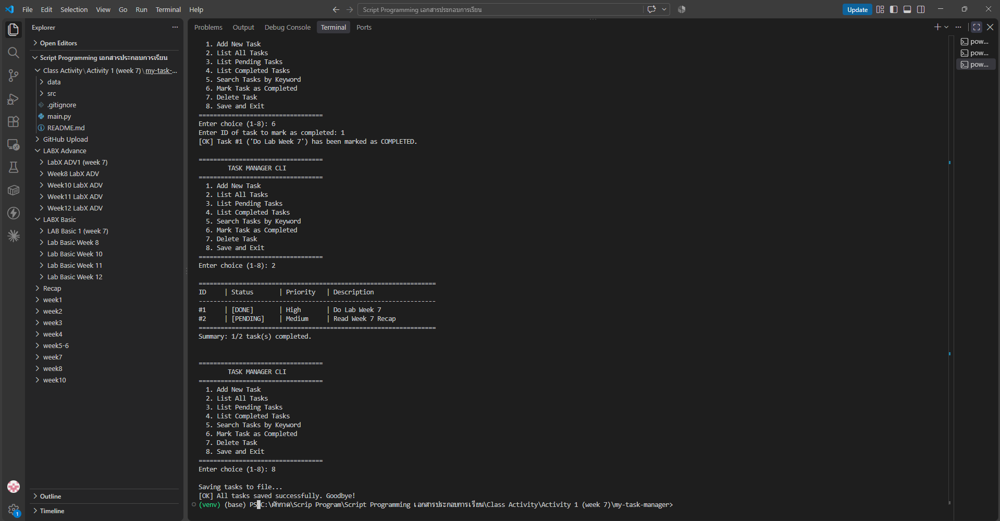

# Class Activity 1 (Week 7): Building a Simple CLI Application

โปรแกรมจัดการงาน (Task Manager) แบบ **Command-Line Interface** เขียนด้วย Python เพิ่ม/ดู/ค้นหา/ปิด/ลบงานได้จากเมนูใน Terminal และบันทึกงานลงไฟล์ `data/tasks.json` ให้ข้อมูลยังอยู่แม้ปิดโปรแกรมไปแล้ว

## 🎯 สิ่งที่ฝึกในกิจกรรมนี้
- **แบ่งโปรเจกต์เป็นส่วน ๆ:** `main.py` จัดการเมนู, `task_logic.py` จัดการงาน, `task_data.py` อ่าน/เขียนไฟล์
- **จัดการข้อผิดพลาด:** ใช้ `try...except` กับ ID ที่ไม่ใช่ตัวเลข, ไฟล์ JSON เสีย และการกด Ctrl+C (บันทึกก่อนออกเสมอ)
- **บันทึกข้อมูลถาวร:** ใช้ `json.load` / `json.dump` (`ensure_ascii=False` จึงเก็บภาษาไทยได้)

## 📁 โครงสร้างไฟล์
```text
my-task-manager/
├── main.py              # เมนู CLI 1–8 และการตรวจสอบ input
├── src/
│   ├── __init__.py
│   ├── task_logic.py    # add / list / complete / delete / search
│   └── task_data.py     # load_tasks / save_tasks (JSON)
├── data/tasks.json      # งานที่บันทึกไว้ (จากการรันจริง)
├── screenshots/         # ภาพผลการรัน
└── .gitignore
```

## ▶️ วิธีรัน
```powershell
cd my-task-manager
python main.py
```
ไม่ต้องติดตั้งไลบรารีเพิ่ม (ใช้แค่ไลบรารีมาตรฐาน `json`, `os`, `sys`)

| เมนู | ทำอะไร |
|:-:|---|
| 1 | เพิ่มงานใหม่ พร้อมระดับความสำคัญ Low / Medium / High |
| 2 | แสดงงานทั้งหมด (`[DONE]` / `[PENDING]`) |
| 3 / 4 | แสดงเฉพาะงานที่ค้าง / ทำเสร็จแล้ว |
| 5 | ค้นหางานด้วยคำสำคัญ (ไม่สนตัวพิมพ์เล็ก-ใหญ่) |
| 6 | ทำเครื่องหมายว่างานเสร็จ |
| 7 | ลบงาน (ถามยืนยันก่อน) |
| 8 | บันทึกและออก |

## 🖼️ ผลลัพธ์
ขั้นตอนที่รัน: เพิ่มงาน `Do Lab Week 7` (High) → เพิ่มงาน `Read Week 7 Recap` (Medium) → เมนู 6 ปิดงาน #1 → เมนู 2 แสดงงานทั้งหมด → เมนู 8 บันทึกและออก

ผลเมนู 2 มีงาน **1 งาน `[DONE]`** และ **1 งาน `[PENDING]`** (`Summary: 1/2 task(s) completed.`) ตรงกับข้อมูลที่บันทึกใน [`data/tasks.json`](data/tasks.json)



## 🔧 สิ่งที่ปรับจากโค้ดต้นแบบ
- ล้าง `data/tasks.json` ตัวอย่างของอาจารย์ (`"101"`, `"102"`) ให้เป็น `[]` เพื่อสร้างงานของตัวเองจากการรันจริง
- แก้เส้นใต้เมนูให้ยาว 34 ตัวอักษรเท่ากับเส้นบน (เดิมเป็น 32)

## 🤖 Responsible AI
ใช้ AI ช่วยอ่านโค้ด ทดสอบ และเขียน README โดยผลลัพธ์ในภาพมาจากการรันจริงบนเครื่องของนักศึกษา และตรวจได้จาก `data/tasks.json`

> โค้ดอ้างอิงจาก repo ของอาจารย์: Class_activity_1_Building-a-Simple-CLI-Application
