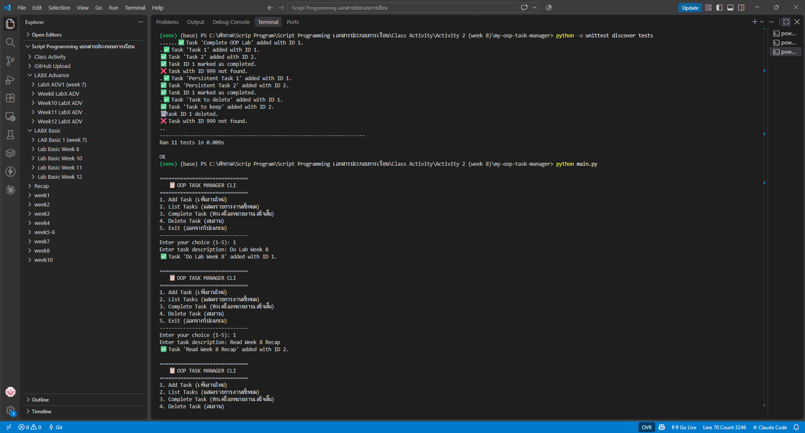
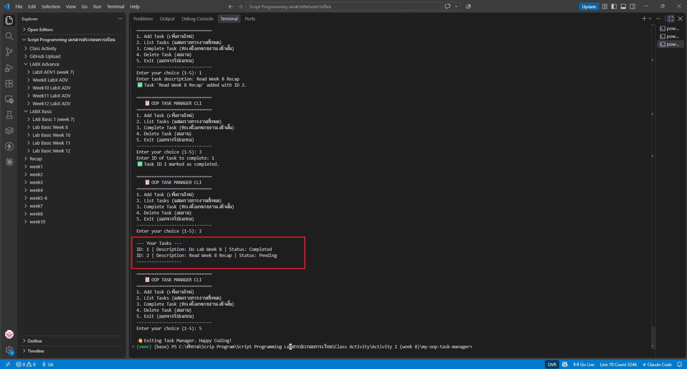

# Class Activity 2 (Week 8): OOP Fundamentals & Refactoring the CLI Task Manager

นำ Task Manager จาก Activity 1 (แบบ procedural ที่เก็บงานเป็น `dict`) มาเขียนใหม่แบบ **OOP** โดยสร้างคลาส `Task` แทนงาน 1 รายการ และคลาส `TaskManager` ที่ดูแลรายการงานทั้งหมดและการบันทึก/โหลดไฟล์ JSON

## 🎯 สิ่งที่ฝึกในกิจกรรมนี้
- **Class vs Object:** `Task` คือพิมพ์เขียว ส่วน `Task(1, "Do Lab")` คือ object ที่สร้างจริง
- **`__init__` และ `self`:** `self` คือ object ตัวที่กำลังถูกเรียกใช้ จึงเก็บค่าแยกกันได้ในแต่ละงาน
- **Encapsulation:** ข้อมูล (`completed`) กับพฤติกรรม (`mark_complete()`) อยู่ในคลาสเดียวกัน
- **Dunder methods:** `__str__` สำหรับผู้ใช้ (`print(task)`) และ `__repr__` สำหรับ debug
- **Serialization:** `to_dict()` แปลง object → dict เพื่อบันทึก JSON และ `_load_tasks()` แปลงกลับเป็น object

## ✍️ TODO ที่เติมใน starter code
| TODO | ไฟล์ | สิ่งที่เขียน |
|:-:|---|---|
| 1.1 | `src/task.py` | `__init__` กำหนด `self.id`, `self.description`, `self.completed` |
| 1.2 | `src/task.py` | `mark_complete()` เปลี่ยน `self.completed = True` |
| 1.3 | `src/task.py` | `to_dict()` คืน dict ที่มี key `id`, `description`, `completed` |
| 1.4 | `src/task.py` | `__str__` คืน `ID: 1 \| Description: ... \| Status: Completed/Pending` |
| 1.5 | `src/task.py` | `__repr__` คืน `Task(id=1, description='...', completed=False)` |
| 2.5 | `src/task_manager.py` | `add_task()` สร้าง `Task` ใหม่ เพิ่มลงลิสต์ เลื่อน `next_id` แล้วบันทึกไฟล์ |
| 2.6 | `src/task_manager.py` | `list_tasks()` วนพิมพ์ทุกงาน (เรียก `__str__` อัตโนมัติ) |
| 2.7 | `src/task_manager.py` | `complete_task()` หา task ตาม id แล้วเรียก `mark_complete()` + บันทึก |
| 2.8 | `src/task_manager.py` | `delete_task()` กรองงานที่ id ไม่ตรงออก ถ้าจำนวนลดลงแปลว่าลบสำเร็จ |

TODO 2.1–2.4 (โหลด/บันทึกไฟล์ และหา `next_id`) อาจารย์เขียนไว้ให้แล้วใน starter code

## 📁 โครงสร้างไฟล์
```text
my-oop-task-manager/
├── main.py                  # เมนู CLI 1–5 (สร้าง TaskManager แล้วเรียก method ตามเมนู)
├── src/
│   ├── task.py              # คลาส Task
│   └── task_manager.py      # คลาส TaskManager (+ JSON persistence)
├── tests/                   # unit tests ของอาจารย์ 11 ข้อ
├── data/tasks.json          # งานที่บันทึกไว้ (จากการรันจริง)
└── screenshots/             # ภาพผลการรัน
```

## ▶️ วิธีรัน
```powershell
cd my-oop-task-manager
python -m unittest discover tests   # ตรวจว่าเติม TODO ถูกต้อง (ต้องผ่าน 11/11)
python main.py
```
ไม่ต้องติดตั้งไลบรารีเพิ่ม

## 🖼️ ผลลัพธ์
**1) Unit tests ผ่าน 11/11** (`python -m unittest discover tests` → `Ran 11 tests ... OK`) และเริ่มเพิ่มงานผ่านเมนู 1



**2) เมนู 2 แสดงงานทั้งหมด** มีงาน **1 งาน `Completed`** และ **1 งาน `Pending`** ตรงกับข้อมูลใน [`data/tasks.json`](data/tasks.json)

ขั้นตอน: เพิ่ม `Do Lab Week 8` → เพิ่ม `Read Week 8 Recap` → เมนู 3 ปิดงาน ID 1 → เมนู 2 → เมนู 5 ออก



## 🤖 Responsible AI
ใช้ AI ช่วยอธิบายและเติมโค้ดตาม TODO แล้วตรวจความถูกต้องด้วย unit tests ของอาจารย์ (ผ่าน 11/11) ผลลัพธ์ในภาพมาจากการรันจริงบนเครื่องของนักศึกษา

> โค้ดตั้งต้นและ unit tests จาก repo ของอาจารย์: Class_activity_2_Object_Oriented_Programmin_OOP_Fundamentals_Refactoring_the_CLI_Task_Manager (โฟลเดอร์ `starter_code`)
