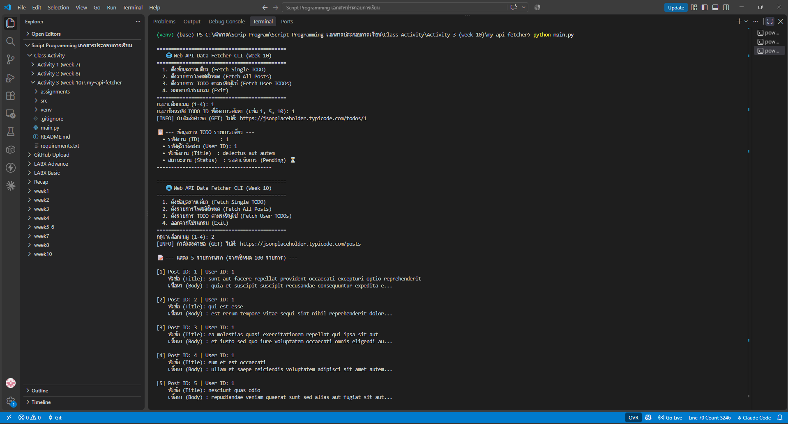
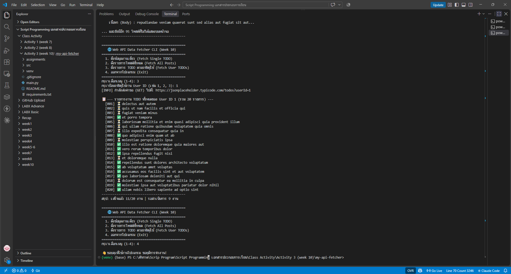
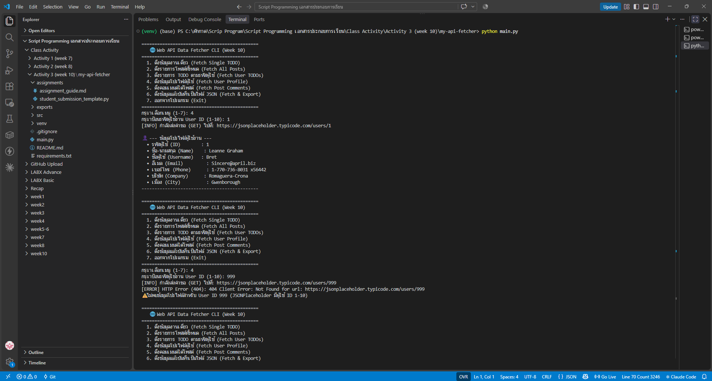
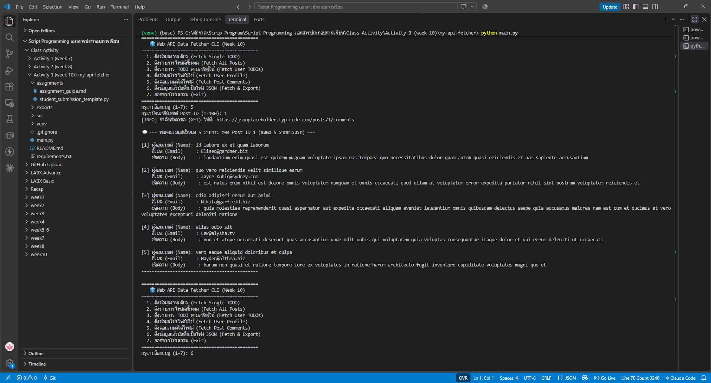
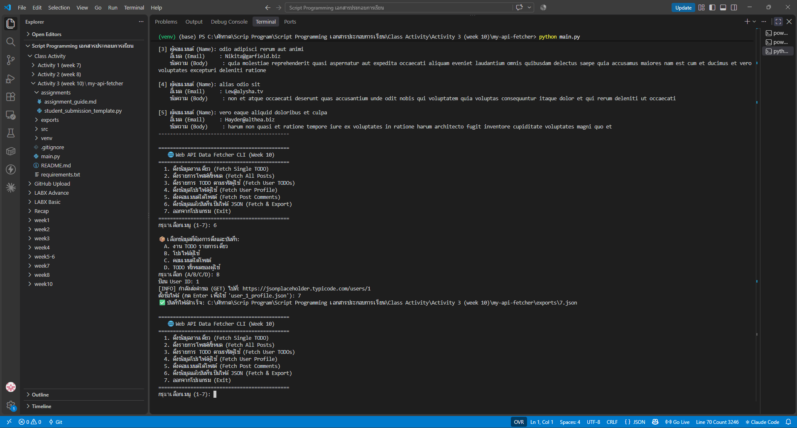
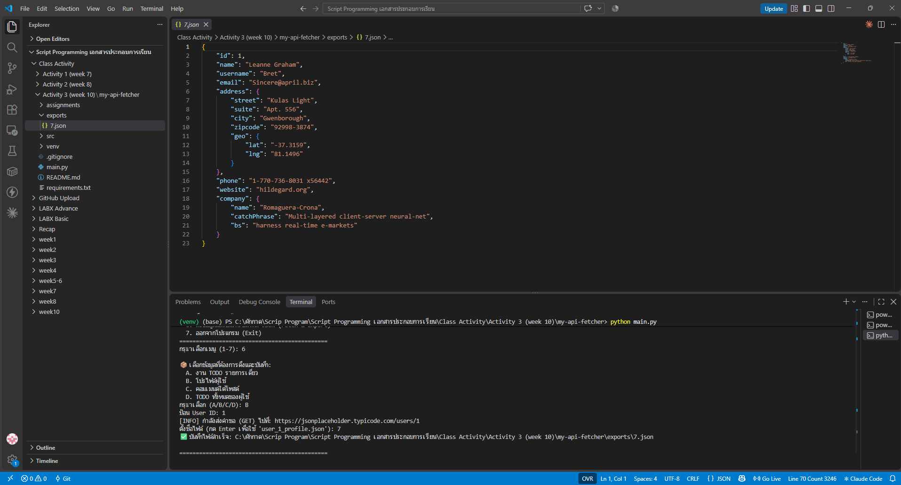

# Class Activity 3 (Week 10): Interacting with Web APIs – Fetching and Processing JSON Data

โปรแกรม CLI ที่ดึงข้อมูลจาก **REST API** ของ [JSONPlaceholder](https://jsonplaceholder.typicode.com) (API ทดลองฟรีที่มีข้อมูลสมมติ) ด้วยไลบรารี `requests` แล้วแปลง JSON เป็น `dict` / `list` ของ Python มาแสดงผลในเทอร์มินัล

## 🎯 สิ่งที่ฝึกในกิจกรรมนี้
- **HTTP GET:** ส่งคำขอด้วย `requests.get(url, timeout=10)` ตั้ง `timeout` ไว้เสมอเพื่อไม่ให้โปรแกรมค้าง
- **ตรวจสถานะ:** `response.raise_for_status()` โยน error ถ้าได้ 4xx/5xx (เช่น 404 เมื่อขอ ID ที่ไม่มี)
- **JSON → Python:** `response.json()` ได้ `dict` (ข้อมูลชิ้นเดียว) หรือ `list` (หลายชิ้น)
- **Query parameter:** `/todos?userId=1` ให้เซิร์ฟเวอร์กรองข้อมูลให้
- **Error handling:** แยกจับ `HTTPError`, `ConnectionError`, `Timeout` และตรวจ input ที่ไม่ใช่ตัวเลข

## 📁 โครงสร้างไฟล์
```text
my-api-fetcher/
├── main.py              # เมนู CLI 1–7, การแสดงผล และ prompt_positive_int (ตรวจ input)
├── src/
│   ├── api_client.py    # คลาส APIClient: _make_request + fetch_* ทั้ง 5 แบบ
│   └── exporter.py      # [ต่อยอด] export_to_json_file → โฟลเดอร์ exports/
├── exports/7.json       # ไฟล์ JSON ที่บันทึกจากเมนู 6 (จากการรันจริง)
├── assignments/         # คู่มือและ template งานต่อยอดของอาจารย์ (ต้นฉบับ)
├── screenshots/         # ภาพผลการรัน
└── requirements.txt     # requests
```

## ▶️ วิธีรัน (Windows PowerShell)
```powershell
cd my-api-fetcher
python -m venv venv
venv\Scripts\Activate.ps1
pip install -r requirements.txt
python main.py
```
ต้องต่ออินเทอร์เน็ต

| เมนู | Endpoint | ผลลัพธ์ |
|:-:|---|---|
| 1. Fetch Single TODO | `GET /todos/{id}` | งาน 1 รายการ: ID, User ID, Title, สถานะ |
| 2. Fetch All Posts | `GET /posts` | โพสต์ทั้งหมด 100 รายการ (แสดง 5 รายการแรก) |
| 3. Fetch User TODOs | `GET /todos?userId={id}` | งานทั้งหมดของผู้ใช้ + สรุปจำนวนที่เสร็จ/ค้าง |
| 4. Fetch User Profile ⭐ | `GET /users/{id}` | ชื่อ, username, อีเมล, เบอร์โทร, บริษัท (`company.name`), เมือง (`address.city`) |
| 5. Fetch Post Comments ⭐ | `GET /posts/{id}/comments` | จำนวนคอมเมนต์ทั้งหมด + ชื่อ/อีเมล/ข้อความ 5 รายการแรก |
| 6. Fetch & Export ⭐ | (เลือก A–D) | ดึงข้อมูลแล้วบันทึกเป็นไฟล์ `exports/*.json` |
| 7. Exit | – | ออกจากโปรแกรม |

⭐ = เมนูที่เพิ่มจากงานต่อยอด

## ⭐ งานต่อยอด (assignments/assignment_guide.md)
พัฒนาต่อในโปรเจกต์เดิม (แทนการใช้ไฟล์ template แยก) เพื่อให้โค้ดอยู่เป็นระบบเดียวกัน

| Task | สิ่งที่ทำ | ไฟล์ |
|---|---|---|
| 1. User Profile | `fetch_user_profile()` + แสดงข้อมูลซ้อนด้วย `user.get("company", {}).get("name")` ไม่แครชแม้ไม่มี key; ID ที่ไม่มี (เช่น 999 → HTTP 404) แจ้งว่าไม่พบ | `src/api_client.py`, `main.py` |
| 2. Post Comments | `fetch_post_comments()` + แสดงจำนวนทั้งหมดและ 5 รายการแรก | `src/api_client.py`, `main.py` |
| 3. Export to JSON | `export_to_json_file()` ใช้ `utf-8`, `indent=4`, `ensure_ascii=False`, ดักจับ `PermissionError` / `OSError` / `TypeError`, และตัด path ออกจากชื่อไฟล์ให้บันทึกได้เฉพาะใน `exports/` | `src/exporter.py` |
| 4. CLI & Validation | เมนู 1–7 และฟังก์ชัน `prompt_positive_int()` ใช้ตรวจทุก ID: ป้อน `abc`, `0`, `-3` → แจ้ง error แล้วกลับเมนู | `main.py` |

## 🖼️ ผลลัพธ์
**เมนู 1 Fetch Single TODO และเมนู 2 Fetch All Posts** (100 โพสต์ แสดง 5 รายการแรก)



**เมนู 3 Fetch TODOs by User ID** (User 1 มี 20 งาน เสร็จ 11 ค้าง 9)



**⭐ เมนู 4 User Profile** — User 1 แสดงข้อมูลครบ รวม `company.name` และ `address.city` / User 999 ได้ HTTP 404 → แจ้ง "ไม่พบข้อมูล" ไม่แครช



**⭐ เมนู 5 Post Comments** — Post 1 มีคอมเมนต์ทั้งหมด 5 รายการ แสดงชื่อ อีเมล และข้อความ



**⭐ เมนู 6 Fetch & Export** — เลือก B (โปรไฟล์ User 1) ตั้งชื่อไฟล์ `7` → โปรแกรมเติม `.json` ให้เป็น `exports/7.json`



**⭐ ไฟล์ JSON ที่บันทึกจริง** [`exports/7.json`](exports/7.json) (จัดรูปแบบด้วย `indent=4` มีข้อมูลซ้อน `address.geo` และ `company` ครบ)



## 🧪 การทดสอบก่อนส่ง
- เมนูทั้ง 3 ทำงานถูกต้อง (ทดสอบด้วยข้อมูลจำลองรูปแบบเดียวกับ JSONPlaceholder)
- ป้อน `abc` แทนตัวเลข → แจ้ง error และกลับเมนู ไม่แครช
- เมื่อเชื่อมต่อเซิร์ฟเวอร์ไม่ได้ → แสดง `[ERROR] Connection Error` และกลับเมนู ไม่แครช
- ไม่พบบั๊กในโค้ดเมนู 1–3 ของอาจารย์
- เมนู 4–6 ทดสอบกรณี: User 999 (404), ป้อน `abc`/`-3`, ตัวเลือก export ผิด, ชื่อไฟล์มี path (`my/../evil` → บันทึกเป็น `exports/evil.json`) ทุกกรณีไม่แครช

## ⚖️ Responsible API use
- ตั้ง `timeout` ทุกคำขอ และไม่ยิงคำขอถี่เกินจำเป็น (เมนูละ 1 คำขอ)
- API นี้เป็นข้อมูลสมมติเพื่อการเรียน ถ้าใช้ API จริงที่ต้องมี API key ต้องเก็บ key ใน `.env` (อยู่ใน `.gitignore`) ห้ามฝังในโค้ด

> โค้ดจาก repo ของอาจารย์: Class_activity_3_Interacting_with_Web_APIs_Fetching_and_Processing_JSON_Data · README เขียนโดยใช้ AI ช่วย ผลในภาพมาจากการรันจริงบนเครื่องของนักศึกษา
