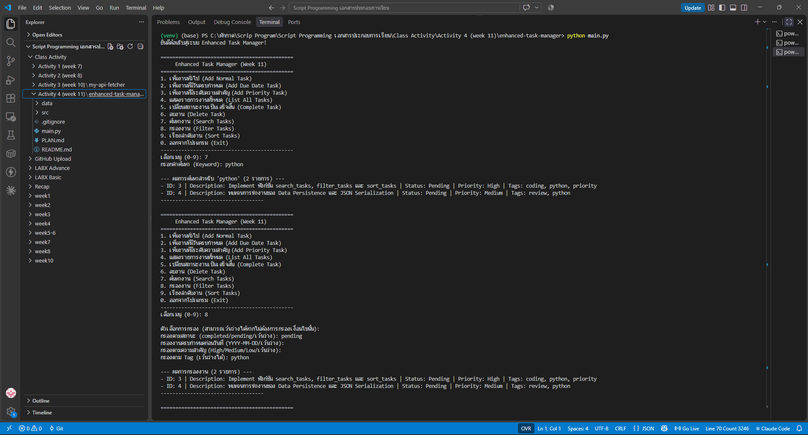
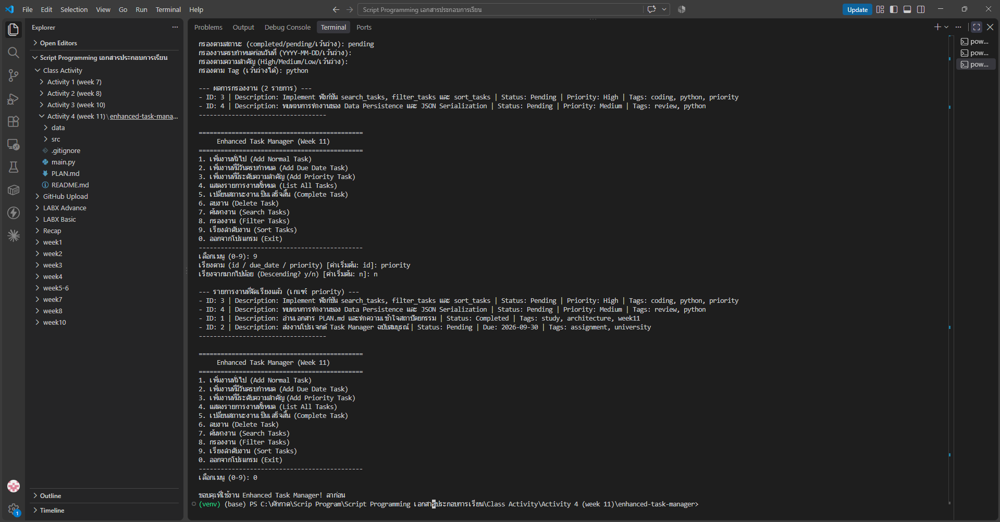

# Class Activity 4 (Week 11): Project Planning & Design – Building an Enhanced Task Manager

ต่อยอด Task Manager จาก Activity 1–2 ให้เป็นโปรเจกต์ที่**วางแผนและออกแบบก่อนเขียน** ([`PLAN.md`](PLAN.md)) แยกเป็น 4 ชั้นตามหลัก Separation of Concerns และรองรับงาน 3 ประเภทด้วย **Inheritance** พร้อมฟีเจอร์ **ค้นหา / กรอง / เรียงลำดับ** ที่นักศึกษาต้องเขียนเอง

## 🏗️ สถาปัตยกรรม
| ชั้น | ไฟล์ | หน้าที่ |
|---|---|---|
| Presentation | `src/cli_interface.py` | เมนู 0–9, รับ input และตรวจความถูกต้อง |
| Business Logic | `src/task_manager.py` | เพิ่ม/ปิด/ลบงาน และ **search / filter / sort** |
| Domain Models | `src/task.py` | `Task` → คลาสลูก `DueDateTask` (มีวันครบกำหนด), `PriorityTask` (High/Medium/Low) |
| Data Access | `src/data_persistence.py` | บันทึก/โหลด `data/tasks.json` และสร้าง object ให้ถูกคลาสจากฟิลด์ `_type` |

`main.py` ทำหน้าที่ประกอบชิ้นส่วน: สร้าง `TaskManager` แล้วส่งให้ `CLIInterface`

## ✍️ ฟังก์ชันที่เขียนเพิ่ม (`src/task_manager.py`)
| ฟังก์ชัน | การทำงาน |
|---|---|
| `search_tasks(keyword)` | หาคำใน description **หรือ** tags แบบไม่สนตัวพิมพ์เล็ก-ใหญ่ |
| `filter_tasks(status, due_date_before, priority, tags)` | กรองหลายเงื่อนไขพร้อมกัน (AND): สถานะ, งานที่ครบกำหนดก่อนวันที่ระบุ (เฉพาะ `DueDateTask`), ระดับความสำคัญ (เฉพาะ `PriorityTask`), และ tag |
| `sort_tasks(criterion, reverse)` | เรียงตาม `id`, `due_date` หรือ `priority` (High → Low) ขึ้น/ลงได้ งานที่ไม่มีค่านั้นจะอยู่ท้ายเสมอ |

ใช้ `isinstance()` แยกประเภทงาน เช่น กรองวันที่เฉพาะ object ที่เป็น `DueDateTask` ซึ่งเป็นตัวอย่างการใช้ประโยชน์จาก Inheritance

**ปรับ `src/cli_interface.py` เล็กน้อย:**
- ตรวจค่าสถานะ (`completed`/`pending`) และ priority ก่อนกรอง
- จับวันที่รูปแบบผิดใน Filter → แจ้งเตือนแทนการแครช (เดิม `strptime` จะโยน `ValueError` จนโปรแกรมหยุด)
- เกณฑ์เรียงที่ไม่รู้จัก → แจ้งแล้วใช้ `id`
- ลบข้อความ "Assignment / ยังไม่ได้ Implement" ออกจากเมนู

**ข้อมูลตั้งต้น:** ใช้งานตัวอย่าง ID 1–4 ของอาจารย์ใน `data/tasks.json` (ลบรายการทดสอบ `"2"` วันที่ 2021 ที่ค้างอยู่ออก)

## ▶️ วิธีรัน
```powershell
cd enhanced-task-manager-design
python main.py
```
ไม่ต้องติดตั้งไลบรารีเพิ่ม

## 🖼️ ผลลัพธ์
**เมนู 7 ค้นหา `python`** → พบ 2 งาน (ID 3 มี `python` ใน tags, ID 4 ก็เช่นกัน)
**เมนู 8 กรอง** สถานะ `pending` + Tag `python` → 2 งาน (ID 3, 4)



**เมนู 9 เรียงตาม `priority`** (น้อยไปมาก) → High (ID 3) → Medium (ID 4) แล้วตามด้วยงานที่ไม่มี priority (ID 1, 2) เรียงตาม id



## 🧪 การทดสอบก่อนส่ง
ทดสอบในเครื่อง: ค้นหา `python` (เจอ 2), ค้นหา `zzz` (ไม่พบ), กรอง pending+tag `python`, กรองครบกำหนดก่อน 2026-12-31, กรอง priority `high`, วันที่ผิด `2026-13-45`, priority ผิด, เรียงตาม priority / due_date (มากไปน้อย) / เกณฑ์ผิด — ทุกกรณีทำงานถูกต้องและไม่แครช

## 🤖 Responsible AI
ใช้ AI ช่วยเขียนฟังก์ชันตามแนวทางใน docstring ของอาจารย์ ทดสอบทุกกรณีก่อนส่ง และอธิบายเหตุผลไว้ใน README ผลลัพธ์ในภาพมาจากการรันจริงบนเครื่องของนักศึกษา

> โค้ดตั้งต้นและ `PLAN.md` จาก repo ของอาจารย์: Class_Activity_4_Project-Planning-Design-Building-an-Enhanced-Task-Manager
