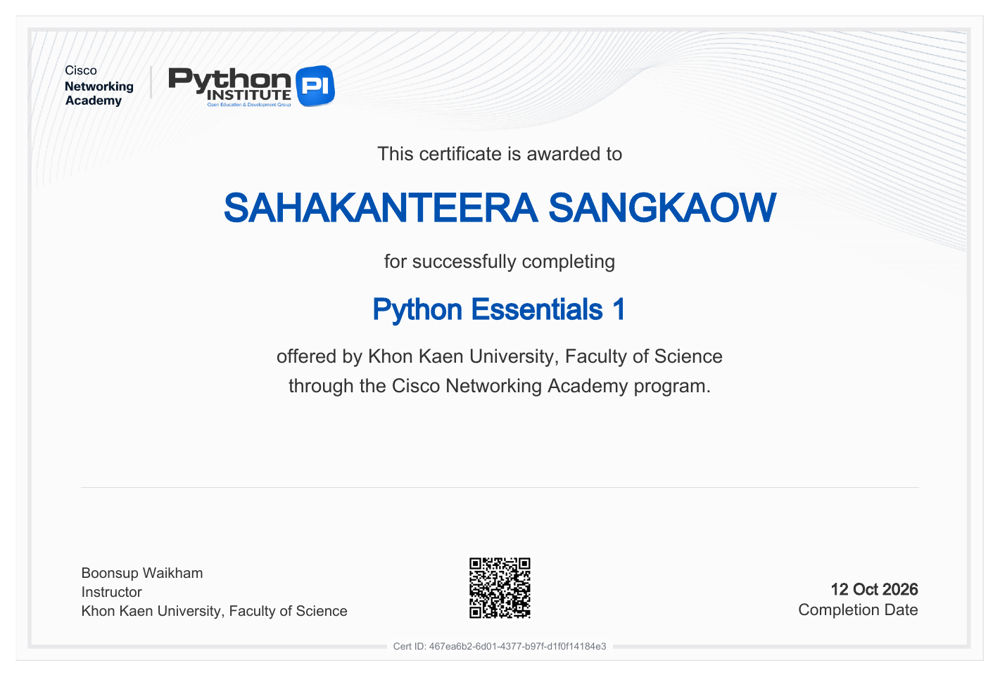
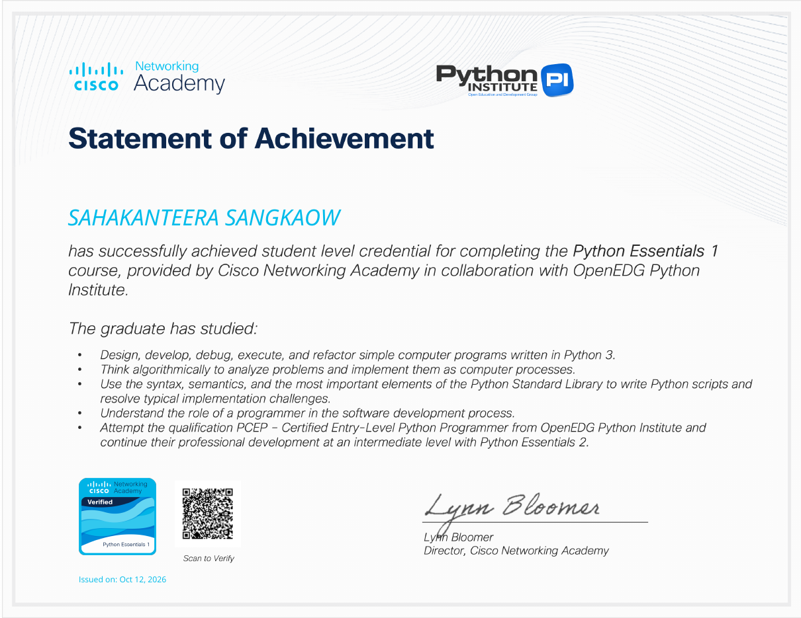
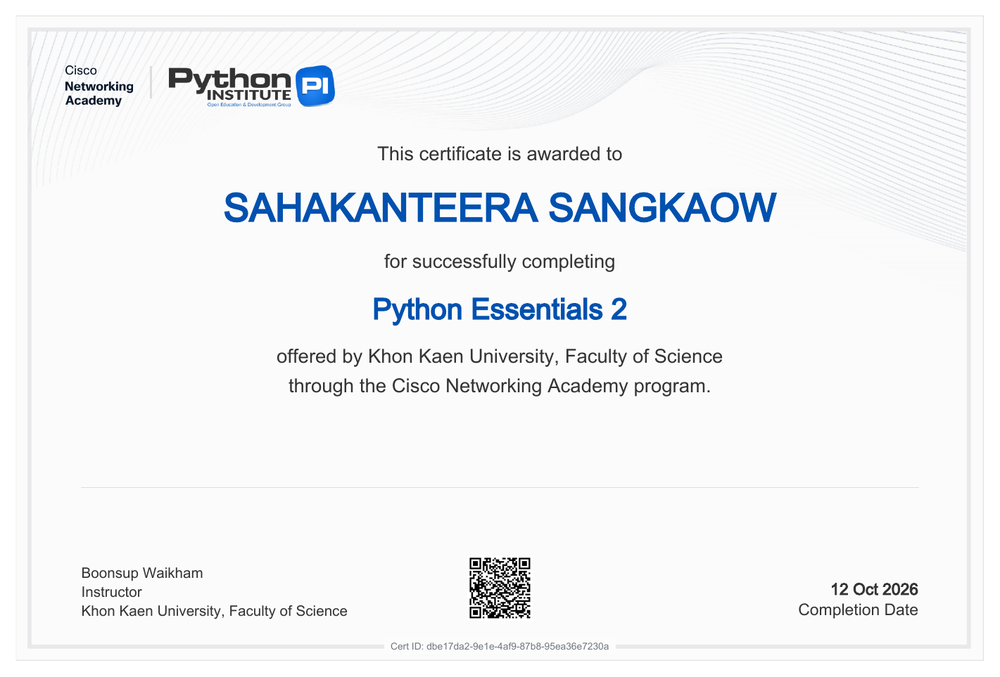
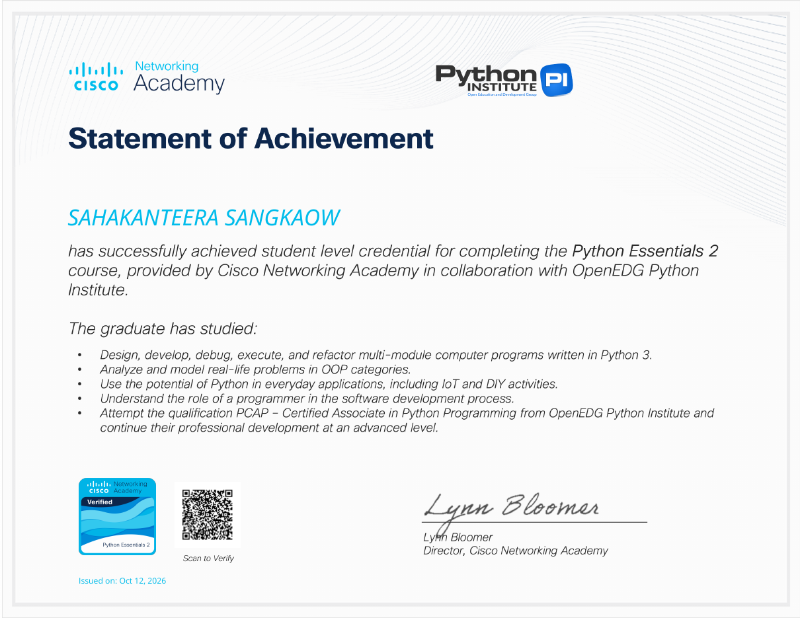
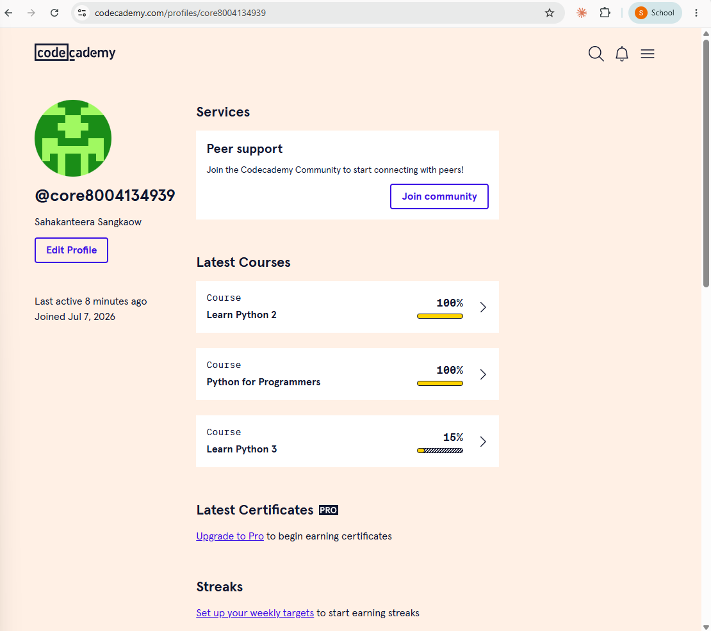

# CP352301 Script Programming

**ภาคเรียน:** 1/2569  
**รหัสวิชา:** CP352301  
**ชื่อรายวิชา:** การเขียนโปรแกรมสคริปต์ (Script Programming)  
**ผู้สอน:** ผศ.บุญสืบ ไวคำ  
**นักศึกษา:** นางสาวสหกานต์ธีรา สังข์ขาว (รหัสนักศึกษา 663380296-6)  
**กลุ่มเรียน (Section):** 2  

---

## 📚 สารบัญรายสัปดาห์

ทุกสัปดาห์อยู่ในโฟลเดอร์ `WeekN` ของตัวเอง ภายในมีงาน Lab, Activity และสรุปการเรียน (Recap) ของสัปดาห์นั้น

| สัปดาห์ | หัวข้อบทเรียน | สรุปการเรียน (Recap) | Lab | Activity |
|:---:|:---|:---:|:---|:---|
| 1 | Introduction to Python & Basic Syntax | [📖 อ่านออนไลน์ (.md)](./Week1/Week1_Recap.md)<br>[📄 ดาวน์โหลด (.docx)](./Week1/Week1_Recap.docx) | [Lab 1 & Activity 1 (Google Colab)](https://colab.research.google.com/drive/1hLCuvBBY4ApzuEtXvrtYkjTNOXyPfN-h?usp=sharing) | (อยู่ใน notebook เดียวกับ Lab) |
| 2 | Control Flow: Conditionals + List Comprehension | [📖 อ่านออนไลน์ (.md)](./Week2/Week2_Recap.md)<br>[📄 ดาวน์โหลด (.docx)](./Week2/Week2_Recap.docx) | [Lab 2.1](./Week2/Week2_Lab2.1.ipynb) · [Lab 2.2](./Week2/Week2_Lab2.2.ipynb) | [Activity 2.1–2.2](./Week2/Week2_Activity2.1-2.2.pdf) |
| 3 | Control Flow: Loops + Generators | [📖 อ่านออนไลน์ (.md)](./Week3/Week3_Recap.md)<br>[📄 ดาวน์โหลด (.docx)](./Week3/Week3_Recap.docx) | [Lab 3 & Activity 3](./Week3/Week3_Lab3_and_Activity3.ipynb) | (อยู่ใน notebook เดียวกับ Lab) |
| 4 | Data Structures: Lists & Tuples | [📖 อ่านออนไลน์ (.md)](./Week4/Week4_Recap.md)<br>[📄 ดาวน์โหลด (.docx)](./Week4/Week4_Recap.docx) | [Lab 4 & Activity 4](./Week4/Week4_Lab4_and_Activity4.ipynb) | (อยู่ใน notebook เดียวกับ Lab) |
| 5 | Data Structures: Dictionaries & Sets | [📖 อ่านออนไลน์ (.md)](./Week5/Week5_Recap.md)<br>[📄 ดาวน์โหลด (.docx)](./Week5/Week5_Recap.docx) | [Lab 5 & Activity 5](./Week5/Week5_Lab5_and_Activity5.ipynb) | (อยู่ใน notebook เดียวกับ Lab) |
| 6 | Functions & Modules | [📖 อ่านออนไลน์ (.md)](./Week6/Week6_Recap.md)<br>[📄 ดาวน์โหลด (.docx)](./Week6/Week6_Recap.docx) | [Lab 6 & Activity 6](./Week6/Week6_Lab6_and_Activity6.ipynb) | (อยู่ใน notebook เดียวกับ Lab) |
| 7 | Web Scraping, Error Handling & Project Structure | [📖 อ่านออนไลน์ (.md)](./Week7/Week7_Recap.md)<br>[📄 ดาวน์โหลด (.docx)](./Week7/Week7_Recap.docx) | [LAB Basic 1: Web Scraping](./Week7/Week7_LabBasic1_WebScraping)<br>[LabX ADV1: Agentic Web Scraper](./Week7/Week7_LabADV1_AgenticWebScraper) | – |
| 8 | OOP Fundamentals & Automating with CSV / JSON Data | [📖 อ่านออนไลน์ (.md)](./Week8/Week8_Recap.md)<br>[📄 ดาวน์โหลด (.docx)](./Week8/Week8_Recap.docx) | [LAB Basic Week 8: CSV & JSON Data Processor](./Week8/Week8_LabBasic_DataProcessor)<br>[LabX ADV Week 8: Agentic Data Processor](./Week8/Week8_LabADV_AgenticDataProcessor) | – |
| 10 | Web APIs, Spreadsheet Automation & Final Project | [📖 อ่านออนไลน์ (.md)](./Week10/Week10_Recap.md)<br>[📄 ดาวน์โหลด (.docx)](./Week10/Week10_Recap.docx) | [LabX BASIC Week 10: Spreadsheet Automator](./Week10/Week10_LabBasic_SpreadsheetAutomator)<br>[LabX ADV Week 10: Spreadsheet Agent](./Week10/Week10_LabADV_SpreadsheetAgent) | – |
| 11 | Automating PDFs & Word Documents | – | [LabX BASIC Week 11: Document Automator](./Week11/Week11_LabBasic_DocumentAutomator)<br>[LabX ADV Week 11: Document Agent](./Week11/Week11_LabADV_DocumentAgent) | – |
| 12 | Automating Communications (Email & SMS) | – | [LabX BASIC Week 12: Email & SMS Automator](./Week12/Week12_LabBasic_EmailSmsAutomator)<br>[LabX ADV Week 12: Agentic Communication Automator](./Week12/Week12_LabADV_AgenticCommAutomator)<br>[Lab 12: Final Project – Enhanced Task Manager](./Week12/Week12_Lab12_FinalProject) | – |

> สรุปแต่ละสัปดาห์มี 2 แบบ: 📖 `.md` เปิดอ่านบน GitHub ได้ทันที และ 📄 `.docx` สำหรับดาวน์โหลดไปเปิดใน Word

## 🧪 Class Activity (คะแนนเสริม)

อยู่ในโฟลเดอร์ [`Class_Activity`](./Class_Activity) แยกจากโฟลเดอร์รายสัปดาห์ตามที่อาจารย์กำหนด

| Activity | หัวข้อ | งาน |
|:---:|:---|:---|
| 1 | Building a Simple CLI Application | [Activity 1: Simple CLI Task Manager](./Class_Activity/Activity1_SimpleCLI_TaskManager) |
| 2 | OOP Fundamentals & Refactoring the CLI Task Manager | [Activity 2: OOP Task Manager](./Class_Activity/Activity2_OOP_TaskManager) |
| 3 | Interacting with Web APIs: Fetching and Processing JSON Data (+ งานต่อยอด) | [Activity 3: Web API Fetcher](./Class_Activity/Activity3_WebAPI_Fetcher) |
| 4 | Project Planning & Design: Building an Enhanced Task Manager | [Activity 4: Enhanced Task Manager](./Class_Activity/Activity4_EnhancedTaskManager) |

## 🏅 ใบรับรองการเรียนรู้ออนไลน์ (Certifications)

| ใบรับรอง | คอร์ส | สถานะ | หลักฐาน |
|:---:|:---|:---:|:---|
| CERT1 | Cisco NetAcad – Python Essentials 1 (Script Programming 1/26) | ✅ ผ่านแล้ว | [Credly Badge](https://www.credly.com/badges/22925c60-3fae-4af1-bd22-0ce2aa63123a/public_url)<br>[📄 Certificate](./Certifications/CERT1_PythonEssentials1_Certificate.pdf)<br>[📄 Statement of Achievement](./Certifications/CERT1_PythonEssentials1_StatementOfAchievement.pdf) |
| CERT2 | Cisco NetAcad – Python Essentials 2 | ✅ ผ่านแล้ว | [Credly Badge](https://www.credly.com/badges/175af70a-d09f-4cd0-9a41-1fde78e0fa25/public_url)<br>[📄 Certificate](./Certifications/CERT2_PythonEssentials2_Certificate.pdf)<br>[📄 Statement of Achievement](./Certifications/CERT2_PythonEssentials2_StatementOfAchievement.pdf) |
| CERT3 | Codecademy – Learn Python 2 | ✅ เรียนจบ 100% | [🖼️ หน้าโปรไฟล์ Codecademy](#cert3-codecademy) (ดูหมายเหตุ) |

### CERT1: Python Essentials 1

<p align="center">
  
  
</p>

### CERT2: Python Essentials 2

<p align="center">
  
  
</p>

### CERT3: Codecademy

<p align="center">
  
</p>

> **หมายเหตุถึงอาจารย์:**
> - เรียน **Learn Python 2** จบครบ **100%** (และ Python for Programmers 100%) ตามภาพหน้าโปรไฟล์ Codecademy ด้านบน
> - **Learn Python 3 ไม่ใช่คอร์สฟรี** เนื้อหาส่วนใหญ่ต้องสมัครสมาชิกแบบเสียเงิน (Plus/Pro) จึงเรียนได้เพียงส่วนที่เปิดให้ฟรี (15%)
> - Codecademy ออก **Certificate of Completion เฉพาะสมาชิก Pro** บัญชีฟรีจึงดาวน์โหลดใบรับรองไม่ได้ จึงแนบภาพหน้าโปรไฟล์เป็นหลักฐานการเรียนจบแทน

## 🗂️ รูปแบบการตั้งชื่อไฟล์

| รูปแบบ | ความหมาย |
|:---|:---|
| `WeekN_Recap.md` / `.docx` | สรุปการเรียนของสัปดาห์ที่ N |
| `WeekN_LabX.Y.ipynb` | Lab ข้อ X.Y ของสัปดาห์ที่ N |
| `WeekN_ActivityX.pdf` | Class Activity ของสัปดาห์ที่ N |
| `WeekN_LabBasicX_<ชื่อ>/` | โปรเจกต์ LabX Basic (มี `README.md` และ `screenshots/`) |

## ▶️ วิธีรันโปรเจกต์ Python (ตัวอย่าง Week 7)
```powershell
cd Week7/Week7_LabBasic1_WebScraping
python -m venv venv
venv\Scripts\Activate.ps1
pip install -r requirements.txt
python main.py
```

## 🤖 การใช้ AI
ใช้ Generative AI เป็นผู้ช่วยการเรียนรู้ตาม prompt ของรายวิชา:
*"As a Python novice, please respond with AI ethics, explainable AI, and responsible AI in mind."*
