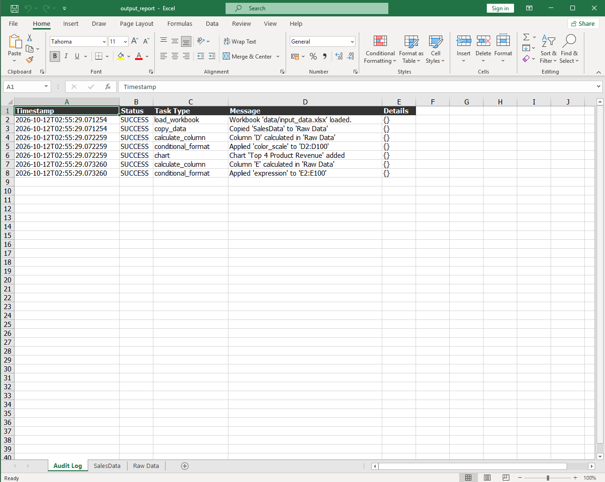
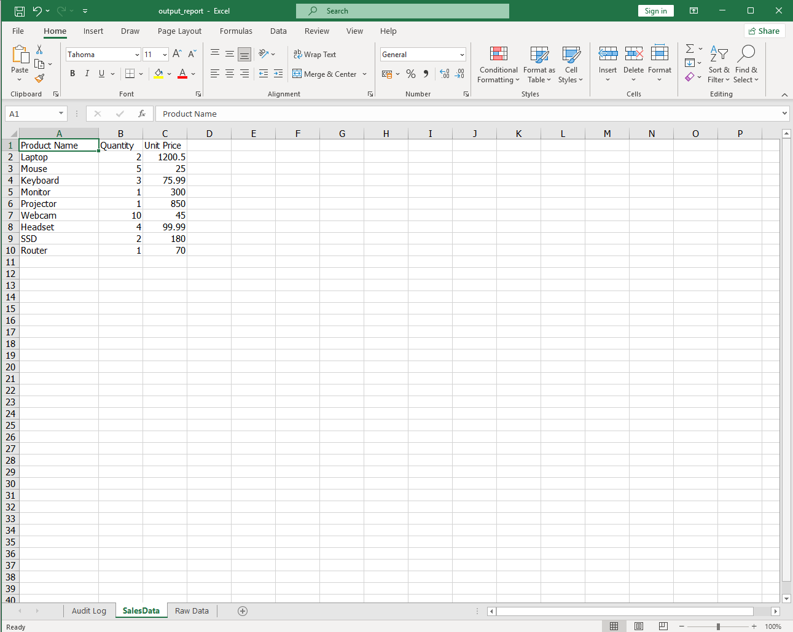
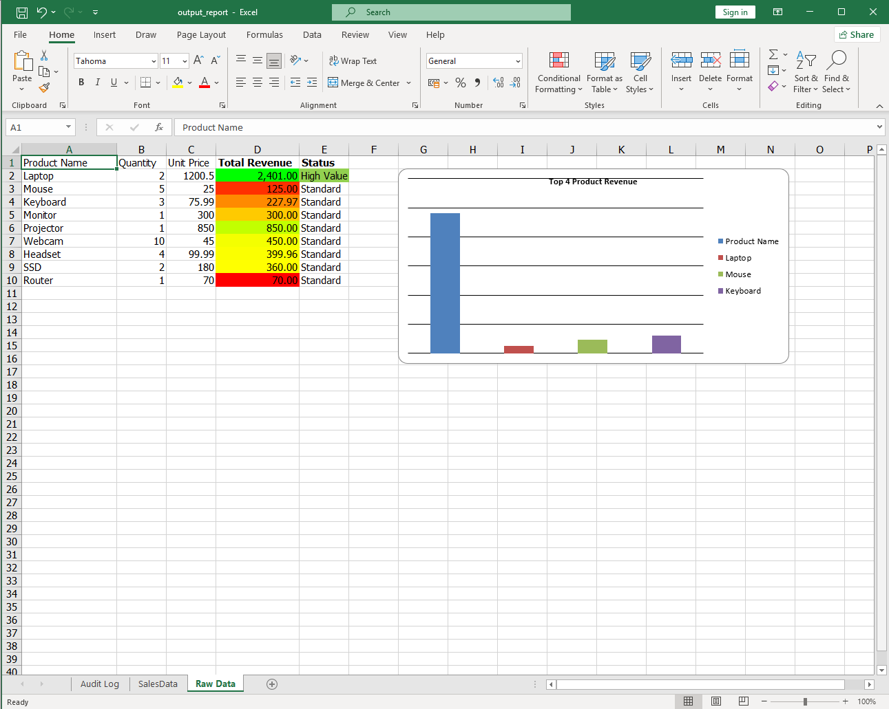

# LabX ADV (Week 10): Advanced Spreadsheet Automation & Agentic Workflows

**Spreadsheet Agent** ที่ทำงานตาม "แผน" ในไฟล์ config (`example_spreadsheet_config.json`) เพื่อแปลงไฟล์ยอดขาย Excel ให้เป็นรายงาน: คัดลอกข้อมูล → ใส่สูตรคำนวณ → จัดรูปแบบตามเงื่อนไข (conditional formatting) → สร้างกราฟ → บันทึก **Audit Log** ทุกขั้นตอนลงชีตแยก ใช้ไลบรารี `openpyxl`

## 🎯 วัตถุประสงค์
- ออกแบบ **config-driven agent** สำหรับงาน Excel: ลำดับงานอยู่ใน JSON แก้แผนได้โดยไม่ต้องแก้โค้ด
- ใส่ **สูตร Excel** อัตโนมัติ (`=B2*C2`, `=IF(D2>1000,"High Value","Standard")`) ให้ Excel คำนวณเอง
- ใช้ **conditional formatting**: color scale (แดง → เหลือง → เขียว) และ highlight ตามเงื่อนไข
- สร้าง **กราฟแท่ง** ใน Excel ด้วย `openpyxl.chart`
- บันทึก **audit trail** ทุก task ลงชีต `Audit Log` เพื่อให้ตรวจสอบย้อนหลังได้

## 📁 โครงสร้างไฟล์
```text
Week10_LabADV_SpreadsheetAgent/
├── main.py                               # โหลด config → ตรวจไฟล์ input → รัน SpreadsheetAgent
├── configs/example_spreadsheet_config.json  # แผนงาน 6 task ของ agent
├── src/
│   ├── spreadsheet_agent.py              # SpreadsheetAgent: ทำ task ตาม config + audit log
│   ├── config_parser.py                  # อ่านและตรวจ config
│   └── utils.py                          # logging
├── create_dummy_data.py                  # สร้างไฟล์ input ตัวอย่าง (ถ้ายังไม่มี)
├── data/
│   ├── input_data.xlsx                   # input: ชีต SalesData (สินค้า 9 รายการ)
│   └── output_report.xlsx                # output: ชีต Audit Log, SalesData, Raw Data
├── screenshots/
└── requirements.txt
```

## 🧩 แผนงานของ agent (6 task)
| # | Task | ทำอะไร |
|:-:|---|---|
| 1 | `copy_data` | คัดลอกชีต `SalesData` ไปเป็นชีตใหม่ `Raw Data` |
| 2 | `calculate_column` | คอลัมน์ D `Total Revenue` = Quantity × Unit Price (`=B{row}*C{row}`) |
| 3 | `conditional_format` | ไล่สี D2:D100 ตามค่า: แดง (ต่ำ) → เหลือง → เขียว (สูง) |
| 4 | `chart` | กราฟแท่ง "Top 4 Product Revenue" วางที่ G2 |
| 5 | `calculate_column` | คอลัมน์ E `Status` = "High Value" ถ้า Revenue > 1000 นอกนั้น "Standard" |
| 6 | `conditional_format` | ไฮไลต์เขียวแถวที่เป็น "High Value" |

## ▶️ วิธีรัน (Windows PowerShell)
```powershell
python -m venv venv
venv\Scripts\Activate.ps1
pip install -r requirements.txt
python main.py
```
> ต้องรันจากในโฟลเดอร์โปรเจกต์ เพราะ config อ้างถึง `data/...` แบบ relative path
> เปิด `data/output_report.xlsx` ด้วย **Microsoft Excel** เพื่อให้สูตร กราฟ และสีแสดงผลครบ

## 🖼️ ผลลัพธ์ (`data/output_report.xlsx`)

**ชีต Audit Log** — บันทึกทุกขั้นตอนพร้อมเวลาและสถานะ



**ชีต SalesData** — ข้อมูลต้นฉบับ (ไม่ถูกแก้ไข)



**ชีต Raw Data** — คอลัมน์ Total Revenue / Status ที่คำนวณด้วยสูตร, การไล่สี และกราฟ



## ⚖️ Responsible automation
- **Audit Log** ในไฟล์ผลลัพธ์บอกได้ทันทีว่า agent ทำอะไรไปบ้าง เมื่อไหร่ สำเร็จหรือไม่ (transparency / explainability)
- ใช้ **สูตร Excel** แทนการคำนวณค่าตายตัว ผู้ใช้ตรวจสอบที่มาของตัวเลขได้ และถ้าแก้ข้อมูล ผลจะอัปเดตเอง
- ไม่แก้ไขชีตต้นฉบับ `SalesData` ทำงานบนสำเนา `Raw Data` และบันทึกเป็นไฟล์ใหม่
- ข้อมูลเป็นข้อมูลตัวอย่าง

> โค้ดอ้างอิงจาก repo แล็บที่อาจารย์ให้ไว้ (Week10_LabX-ADV_-Advanced-Spreadsheet-Automation-Agentic-Workflows)
