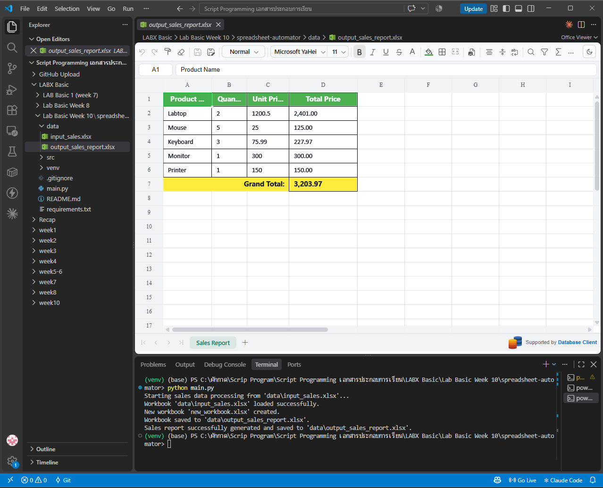

# LabX BASIC (Week 10): Automating Spreadsheets (Excel)

อ่านไฟล์ยอดขาย Excel (`input_sales.xlsx`) คำนวณราคารวมของแต่ละสินค้าและยอดรวมทั้งหมด แล้วสร้างรายงาน Excel ใหม่ที่จัดรูปแบบสวยงาม (`output_sales_report.xlsx`) ด้วยไลบรารี `openpyxl`

## 🎯 วัตถุประสงค์
- เปิด / สร้าง / บันทึก Workbook และ Worksheet ด้วย `openpyxl`
- อ่านข้อมูลทีละแถวด้วย `iter_rows(values_only=True)` และข้ามแถวว่าง
- คำนวณ Total Price = Quantity × Unit Price และ Grand Total
- จัดรูปแบบเซลล์: หัวตารางพื้นเขียวตัวหนังสือขาว, เส้นขอบ, รูปแบบตัวเลข `#,##0.00`, แถว Grand Total พื้นเหลือง, merge cells และปรับความกว้างคอลัมน์อัตโนมัติ
- จัดการ error: ไฟล์ไม่พบ และข้อมูลตัวเลขผิดรูปแบบ (`try` / `except`)

## 📁 โครงสร้างไฟล์
```text
Week10_LabBasic_SpreadsheetAutomator/
├── main.py                    # จุดเริ่มต้น: ตรวจไฟล์ input แล้วเรียก ExcelProcessor
├── src/
│   ├── __init__.py
│   └── excel_processor.py     # คลาส ExcelProcessor: load / create / save / process_sales_data
├── data/
│   ├── input_sales.xlsx           # ข้อมูลนำเข้า
│   └── output_sales_report.xlsx   # รายงานผลลัพธ์ (สร้างตอนรัน)
├── screenshots/
├── requirements.txt
└── .gitignore
```

## ▶️ วิธีรัน (Windows PowerShell)
```powershell
python -m venv venv
venv\Scripts\Activate.ps1
pip install -r requirements.txt
python main.py
```
> ต้องรันจากในโฟลเดอร์โปรเจกต์ เพราะโค้ดอ้างถึงโฟลเดอร์ `data` แบบ relative path

## 📊 ผลลัพธ์

| Product Name | Quantity | Unit Price | Total Price |
|:---|---:|---:|---:|
| Labtop | 2 | 1,200.50 | 2,401.00 |
| Mouse | 5 | 25.00 | 125.00 |
| Keyboard | 3 | 75.99 | 227.97 |
| Monitor | 1 | 300.00 | 300.00 |
| Printer | 1 | 150.00 | 150.00 |
| **Grand Total:** | | | **3,203.97** |

แถวว่างในไฟล์ input (ระหว่าง Monitor กับ Printer) ถูกข้ามอัตโนมัติ



## ⚖️ Responsible automation
- ไม่เขียนทับไฟล์ต้นฉบับ สร้างรายงานเป็นไฟล์ใหม่เสมอ ตรวจสอบย้อนหลังได้
- แถวที่ข้อมูลผิดรูปแบบจะถูกข้ามพร้อมแสดงคำเตือน ไม่ซ่อนข้อผิดพลาดแบบเงียบ ๆ ทำให้อธิบายผลลัพธ์ได้ (explainability)
- ข้อมูลในแล็บเป็นข้อมูลตัวอย่าง ถ้าใช้กับข้อมูลยอดขายจริงควรระวังเรื่องการแชร์ไฟล์และความเป็นส่วนตัว

> โค้ดอ้างอิงจาก repo แล็บที่อาจารย์ให้ไว้ (Week10_LabX-BASIC_-Automating / spreadsheet-automator)
