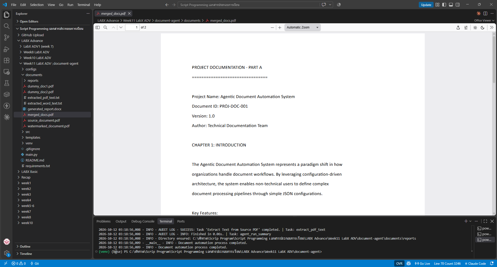
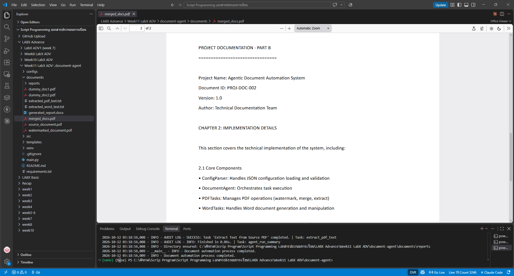
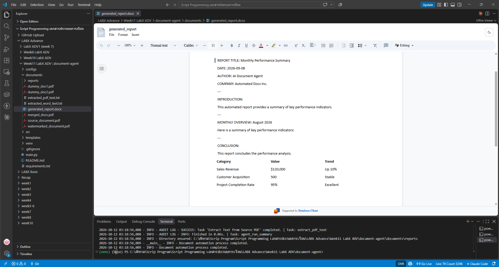
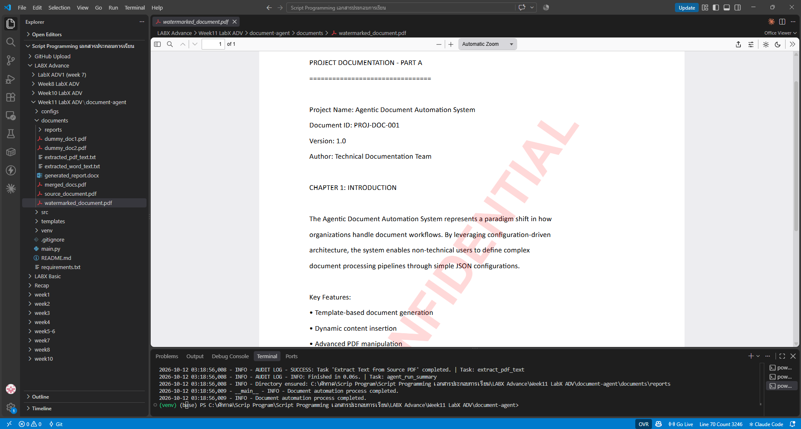

# LabX ADV (Week 11): Project Planning & Design — Agentic Document Automation

**Document Agent** ที่ทำงานตาม "แผน" ในไฟล์ config (`document_automation_config.json`) จัดการเอกสาร PDF และ Word อัตโนมัติ 5 งาน: สร้างรายงาน Word จาก template → ใส่ลายน้ำ PDF → รวม PDF → ดึงข้อความจาก Word และ PDF พร้อมบันทึก **audit report** ทุกขั้นตอน

## 🎯 วัตถุประสงค์
- สร้างเอกสาร Word จาก **template** โดยแทนที่ placeholder `{{KEY}}` และเติมตารางข้อมูล (`python-docx`)
- ใส่ **ลายน้ำ** "CONFIDENTIAL" แบบโปร่งใสเอียงบน PDF (`reportlab` + `PyPDF2`)
- **รวม** PDF หลายไฟล์เป็นไฟล์เดียว
- **ดึงข้อความ** จาก Word และ PDF เก็บเป็นไฟล์ `.txt`
- ออกแบบแบบ **config-driven agent** และบันทึก audit trail เป็น JSON

## 📁 โครงสร้างไฟล์
```text
Week11_LabADV_DocumentAgent/
├── main.py                                  # โหลด config → ตรวจไฟล์ input → รัน DocumentAgent
├── configs/document_automation_config.json  # แผนงาน 5 task + ข้อมูลที่ใช้เติม template
├── templates/report_template.docx           # แม่แบบรายงาน มี placeholder {{REPORT_TITLE}} ฯลฯ
├── src/
│   ├── document_agent.py                    # DocumentAgent: ทำ task ตาม config + audit log
│   ├── word_tasks.py                        # สร้างรายงานจาก template, ดึงข้อความ Word
│   ├── pdf_tasks.py                         # ลายน้ำ, รวม PDF, ดึงข้อความ PDF
│   ├── config_parser.py
│   └── utils.py
├── documents/
│   ├── source_document.pdf, dummy_doc1.pdf, dummy_doc2.pdf   # input
│   ├── generated_report.docx                # output: รายงาน Word
│   ├── watermarked_document.pdf             # output: PDF ที่มีลายน้ำ
│   ├── merged_docs.pdf                      # output: PDF ที่รวมแล้ว (2 หน้า)
│   ├── extracted_word_text.txt / extracted_pdf_text.txt   # output: ข้อความที่ดึงได้
│   └── reports/audit_report_*.json          # output: บันทึกการทำงานของ agent
├── screenshots/                           # ภาพผลลัพธ์จากการรันบนเครื่องจริง (4 รูป)
└── requirements.txt
```

## 🧩 แผนงานของ agent (5 task)
| # | Task | ทำอะไร |
|:-:|---|---|
| 1 | `generate_word_report` | เติม template ด้วยชื่อรายงาน วันที่ ผู้จัดทำ บริษัท และตาราง KPI → `generated_report.docx` |
| 2 | `apply_pdf_watermark` | ใส่ลายน้ำ "CONFIDENTIAL" สีแดงโปร่งใส เอียง 55° → `watermarked_document.pdf` |
| 3 | `merge_pdfs` | รวม `dummy_doc1.pdf` + `dummy_doc2.pdf` → `merged_docs.pdf` |
| 4 | `extract_word_text` | ดึงข้อความจากรายงาน Word → `extracted_word_text.txt` |
| 5 | `extract_pdf_text` | ดึงข้อความจาก PDF ต้นฉบับ → `extracted_pdf_text.txt` |

## ▶️ วิธีรัน (Windows PowerShell)
```powershell
python -m venv venv
venv\Scripts\Activate.ps1
pip install -r requirements.txt
python main.py
```

## 🖼️ ผลลัพธ์
**merged_docs.pdf** (2 หน้า: PART A และ PART B)





**generated_report.docx**



**watermarked_document.pdf**



## 🐞 สิ่งที่แก้ไขจากโค้ดต้นแบบ
| ไฟล์ | ปัญหา | การแก้ไข |
|---|---|---|
| `src/document_agent.py` | template ใช้ placeholder แบบ `{{REPORT_TITLE}}` แต่ config ส่ง key เป็น `REPORT_TITLE` เฉยๆ ระบบจึงแทนที่แค่ชื่อ key แล้วเหลือวงเล็บปีกกาค้างในรายงาน เช่น `REPORT TITLE: {{Monthly Performance Summary}}` | ครอบ key ด้วย `{{ }}` ก่อนส่งไปแทนที่ ผลลัพธ์จึงเป็น `REPORT TITLE: Monthly Performance Summary` |
| `requirements.txt` | ไฟล์ว่าง | ใส่ `PyPDF2`, `python-docx`, `reportlab` |

## ⚖️ Responsible document automation
- ลายน้ำ "CONFIDENTIAL" ช่วยระบุระดับความลับของเอกสาร ลดความเสี่ยงการเผยแพร่โดยไม่ตั้งใจ
- ไม่แก้ไขไฟล์ต้นฉบับ ทุกผลลัพธ์เป็นไฟล์ใหม่ และมี **audit report** บอกว่า agent ทำอะไร เมื่อไหร่ (transparency)
- ตรวจผลลัพธ์ก่อนใช้งานจริงเสมอ ตัวอย่างคือบั๊ก placeholder ที่พบในแล็บนี้ ซึ่งรันผ่านแต่ผลลัพธ์ผิด
- เอกสารในแล็บเป็นข้อมูลตัวอย่าง

> โค้ดอ้างอิงจาก repo แล็บที่อาจารย์ให้ไว้ (LabADV-week-11-Project-Planning-Design-Building-an-Enhanced-Task-Manager)
