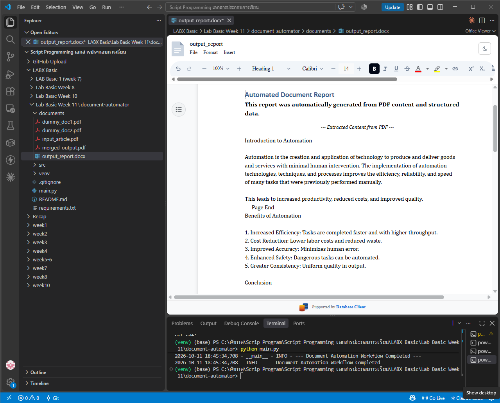
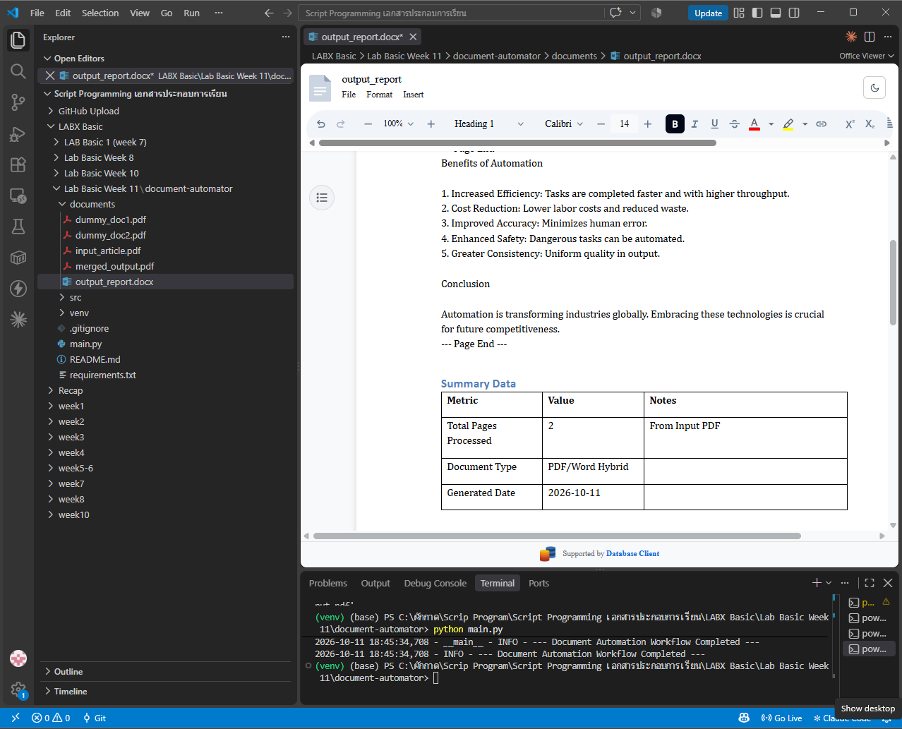
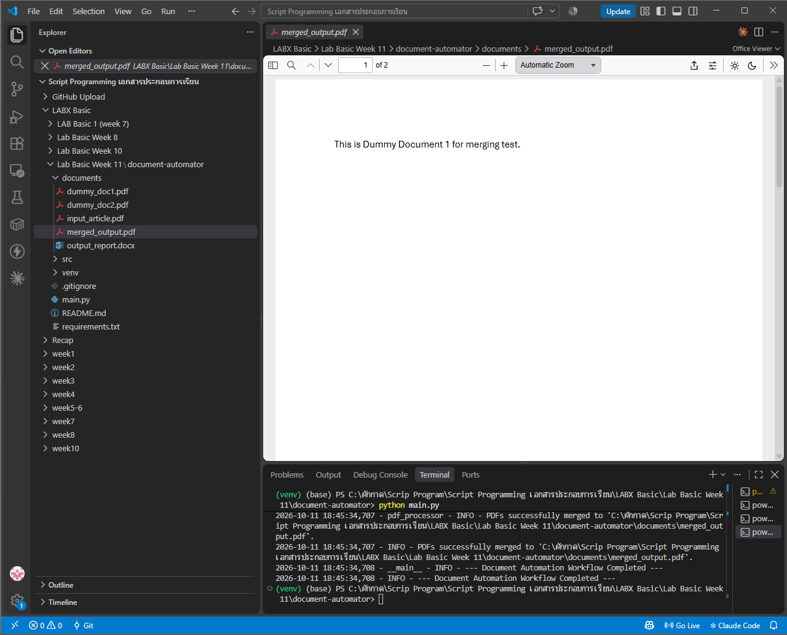

# LabX BASIC (Week 11): Automating PDFs & Word Documents

ดึงข้อความจากไฟล์ PDF แล้วสร้างรายงาน Word (`.docx`) อัตโนมัติ พร้อมรวมไฟล์ PDF หลายไฟล์เป็นไฟล์เดียว โดยใช้ `PyPDF2` และ `python-docx`

## 🎯 วัตถุประสงค์
- อ่านและดึงข้อความจาก PDF ทีละหน้าด้วย `PdfReader`
- รวม (merge) PDF หลายไฟล์ด้วย `PdfWriter`
- สร้างเอกสาร Word: หัวข้อ (heading), ย่อหน้าที่จัดรูปแบบ (ตัวหนา ตัวเอียง ขนาดตัวอักษร จัดกึ่งกลาง) และตาราง (`Table Grid`)
- แยกโค้ดเป็นคลาส `PDFProcessor` และ `WordProcessor` ใน `src/` พร้อม `logging` และจัดการ error

## 📁 โครงสร้างไฟล์
```text
Week11_LabBasic_DocumentAutomator/
├── main.py                    # Task 1: PDF → Word report, Task 2: merge PDFs
├── src/
│   ├── __init__.py
│   ├── pdf_processor.py       # PDFProcessor: extract_text / merge_pdfs / split_pdf
│   ├── word_processor.py      # WordProcessor: heading / paragraph / table / picture / save
│   └── utils.py               # setup_logging, ensure_directory_exists
├── documents/
│   ├── input_article.pdf      # PDF ต้นฉบับ (2 หน้า)
│   ├── dummy_doc1.pdf         # PDF สำหรับทดสอบการรวม
│   ├── dummy_doc2.pdf
│   ├── output_report.docx     # ผลลัพธ์: รายงาน Word (สร้างตอนรัน)
│   └── merged_output.pdf      # ผลลัพธ์: PDF ที่รวมแล้ว (สร้างตอนรัน)
├── screenshots/
├── requirements.txt
└── .gitignore
```

## ▶️ วิธีรัน (Windows PowerShell)
```powershell
python -m venv venv
venv\Scripts\Activate.ps1
pip install -r requirements.txt
python main.py
```

## 📄 ผลลัพธ์

**1. output_report.docx** ประกอบด้วย
- หัวข้อ "Automated Document Report" และคำอธิบายตัวหนา
- ข้อความที่ดึงจาก `input_article.pdf` ครบ 2 หน้า (Introduction to Automation, Benefits of Automation, Conclusion)
- หัวข้อ "Summary Data" และตาราง: Total Pages Processed = 2, Document Type = PDF/Word Hybrid, Generated Date = วันที่รัน





**2. merged_output.pdf** มี 2 หน้า (ภาพแสดง "1 of 2"): หน้า 1 จาก `dummy_doc1.pdf` และหน้า 2 จาก `dummy_doc2.pdf`



## ⚖️ Responsible document automation
- เอกสารต้นฉบับไม่ถูกแก้ไข ผลลัพธ์ถูกเขียนเป็นไฟล์ใหม่เสมอ
- PDF ที่เป็นภาพสแกนจะดึงข้อความไม่ได้ ควรตรวจผลลัพธ์ก่อนนำไปใช้ ไม่เชื่อผลอัตโนมัติ 100%
- ระวังการประมวลผลเอกสารที่มีข้อมูลส่วนบุคคลหรือลิขสิทธิ์ ใช้เฉพาะเอกสารที่มีสิทธิ์ใช้งาน

> โค้ดอ้างอิงจาก repo แล็บที่อาจารย์ให้ไว้ (Lab-Basic-Week-11-document-automator)
