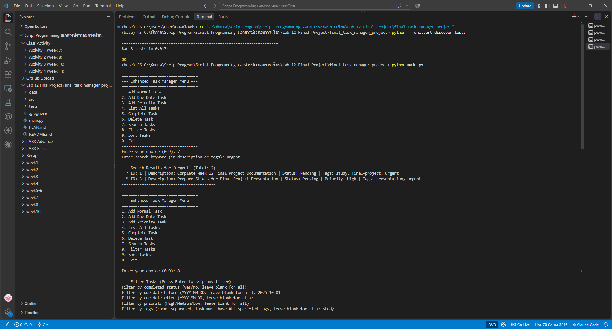
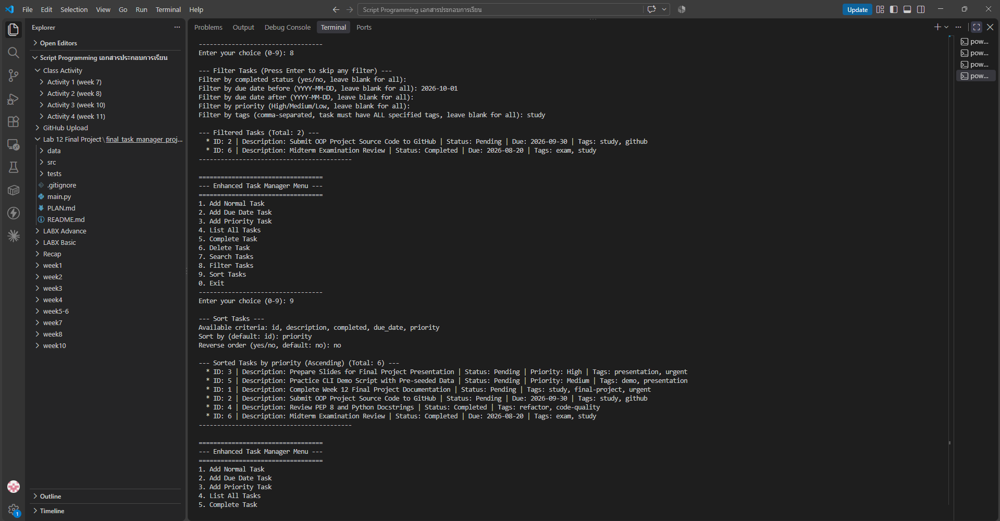

# Lab 12: Final Project Development – Enhanced Task Manager CLI

โปรเจกต์ปลายภาครวมความรู้ทั้งเทอม: Task Manager แบบ CLI ที่รองรับงาน 3 ประเภท (`Task`, `DueDateTask`, `PriorityTask`) ด้วย **Inheritance / Polymorphism**, ติด **Tags**, ค้นหา / กรองหลายเงื่อนไข / เรียงลำดับ, บันทึกเป็น JSON และมี **Unit Tests** ตรวจทุกฟีเจอร์

## 👩‍🎓 ข้อมูลผู้จัดทำ
- **ชื่อ-นามสกุล:** นางสาวสหกานต์ธีรา สังข์ขาว
- **รหัสนักศึกษา:** 663380296-6
- **กลุ่มเรียน:** Section 2
- **รายวิชา:** CP352301 Script Programming (1/2569) · ผู้สอน ผศ.บุญสืบ ไวคำ

## 🏗️ โครงสร้าง (Separation of Concerns)
```text
final_task_manager_project/
├── main.py                    # สร้าง TaskManager + CLIInterface แล้วเริ่มโปรแกรม
├── src/
│   ├── task.py                # Task → DueDateTask, PriorityTask (+ add_tag / remove_tag)
│   ├── data_persistence.py    # อ่าน/เขียน data/tasks.json, สร้าง object ให้ถูกคลาสจาก _type
│   ├── task_manager.py        # CRUD + search / filter / sort
│   └── cli_interface.py       # เมนู 0–9, รับและตรวจ input
├── tests/test_task_manager.py # Unit tests 8 ชุด
├── data/tasks.json            # ข้อมูลงาน (บันทึก/โหลดอัตโนมัติ)
└── screenshots/               # ภาพผลการรัน
```
ดูการออกแบบเต็มได้ที่ [`PLAN.md`](PLAN.md) (เอกสารของอาจารย์)

## 📋 เมนู
| เมนู | ทำอะไร |
|:-:|---|
| 1 / 2 / 3 | เพิ่มงานทั่วไป / งานมีวันครบกำหนด / งานมีระดับความสำคัญ (ใส่ Tags ได้ทุกแบบ) |
| 4 | แสดงงานทั้งหมด |
| 5 / 6 | ปิดงาน / ลบงาน ตาม ID |
| 7 | **Search** หาคำบางส่วนใน description หรือ tags (ไม่สนตัวพิมพ์เล็ก-ใหญ่) |
| 8 | **Filter** สถานะ AND ครบกำหนดก่อน/หลังวันที่ AND priority AND มีทุก tag ที่ระบุ |
| 9 | **Sort** ตาม id / description / completed / due_date / priority ขึ้นหรือลงได้ |
| 0 | ออก |

## ▶️ วิธีรัน
```powershell
cd final_task_manager_project
python -m unittest discover tests   # ต้องผ่าน 8/8
python main.py
```
ไม่ต้องติดตั้งไลบรารีเพิ่ม

## 🐞 สิ่งที่แก้ไขจากโค้ดต้นแบบ
| ไฟล์ | ปัญหา | การแก้ไข |
|---|---|---|
| `src/task_manager.py` | เรียง `due_date` / `priority` แบบมากไปน้อย (`reverse=True`) งานที่ไม่มีวันส่ง/ไม่มี priority กลับไปอยู่**บนสุด** ขัดกับข้อกำหนด "ผลักงานที่ไม่มีวันส่งไปท้ายสุด" | แยกงานที่มีค่ากับไม่มีค่าออกจากกัน เรียงเฉพาะกลุ่มที่มีค่า แล้วต่อกลุ่มที่ไม่มีค่าไว้ท้ายเสมอ |
| `src/cli_interface.py` | Filter: พิมพ์สถานะหรือ priority ผิด ระบบเงียบแล้วไม่กรอง ผู้ใช้ไม่รู้ว่าพิมพ์ผิด / Sort: เกณฑ์ผิดก็เงียบ | แสดง `[Warning]` บอกว่าค่าไหนไม่ถูกต้องและถูกข้าม |
| `data/tasks.json` | มีงานทดสอบ `"101"` ค้างอยู่ | ลบออก เหลืองานตัวอย่าง 6 รายการ |

หลังแก้ unit tests ของอาจารย์ยังผ่าน 8/8

## 🖼️ ผลลัพธ์
**Unit tests ผ่าน 8/8** และ **เมนู 7 ค้นหา `urgent`** → 2 งาน (ID 1, 3 มี `urgent` ใน tags)



**เมนู 8 กรอง** due before `2026-10-01` + tag `study` → 2 งาน (ID 2 ครบกำหนด 2026-09-30, ID 6 ครบกำหนด 2026-08-20)
**เมนู 9 เรียงตาม `priority`** → High (ID 3) → Medium (ID 5) แล้วตามด้วยงานที่ไม่มี priority (ID 1, 2, 4, 6) เรียงตาม id



## 🤖 Responsible AI
ใช้ AI ช่วยอ่านโค้ด หาบั๊ก ทดสอบ และเขียน README โดยทุกการแก้ไขอธิบายเหตุผลไว้ในตารางด้านบน และยืนยันด้วย unit tests ผลในภาพมาจากการรันจริงบนเครื่องของนักศึกษา

> โค้ดตั้งต้นจาก repo ของอาจารย์: Week12_Final_Project_Development-main
