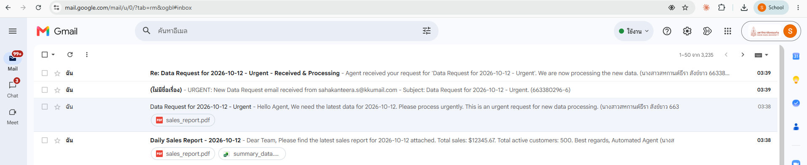
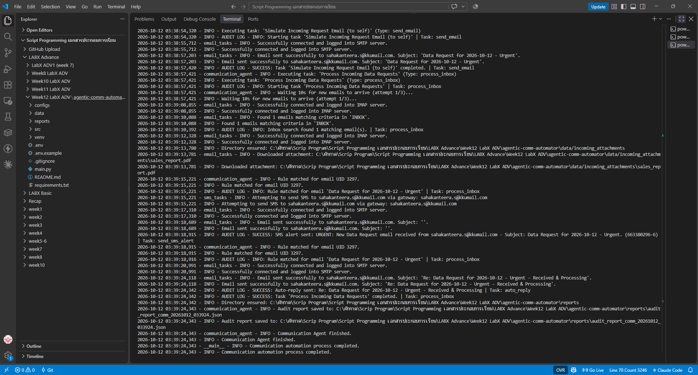

# LabX ADV (Week 12): Agentic Communication Workflows (Advanced Email & SMS)

สร้าง **Communication Agent** ที่อ่านลำดับงานจากไฟล์ JSON แล้วทำงานสื่อสารให้เองตั้งแต่ต้นจนจบ ได้แก่ ส่งอีเมลรายงานพร้อมไฟล์แนบ, จำลองอีเมลคำขอเข้ามา, ตรวจกล่องจดหมายผ่าน IMAP แล้วตัดสินใจตามกฎ (rule-based) เช่น ส่ง SMS แจ้งเตือนหรือตอบกลับอัตโนมัติ และบันทึกทุกขั้นตอนลง audit report

> วิดีโอการสอนของอาจารย์: https://drive.google.com/file/d/1IQG5n4ZtnCZXstkHJfyGHwmwLuJx7XBq/view?usp=sharing

## 🎯 วัตถุประสงค์
- ออกแบบ agent ที่ทำงานตาม **config (JSON)** ไม่ต้องแก้โค้ดเมื่อเปลี่ยนลำดับงาน
- สร้างเนื้อหาอีเมลแบบ **dynamic template** เช่น `{report_date}`, `{sales_figure:.2f}` จากข้อมูลใน context ของ agent
- อ่านอีเมลเข้าผ่าน IMAP แล้วใช้กฎ `if → then` (เช็ก subject, body, ไฟล์แนบ) เพื่อตัดสินใจ
- เก็บรหัสผ่านอย่างปลอดภัยด้วย `.env` และบันทึก log / audit report ทุกขั้นตอน

## 📁 โครงสร้างไฟล์
```text
agentic-comm-automator/
├── main.py                         # จุดเริ่มต้น: โหลด config แล้วสั่ง agent ทำงาน
├── configs/comm_pipeline_config.json   # ลำดับงาน 3 task + กฎของ inbox + context (ชื่อ/รหัสนักศึกษา)
├── src/
│   ├── communication_agent.py      # CommunicationAgent: รันงาน, จัดการ context, ใช้กฎ, audit
│   ├── email_tasks.py              # ส่งอีเมล (SMTP) / ค้นหา-อ่าน-ดาวน์โหลดไฟล์แนบ (IMAP)
│   ├── sms_tasks.py                # ส่ง SMS ผ่าน Email-to-SMS gateway
│   ├── template_renderer.py        # เติมค่าใน template
│   ├── config_parser.py            # โหลดและตรวจ config
│   └── utils.py                    # logging, .env, audit log
├── data/reports/                   # ไฟล์แนบตัวอย่าง: sales_report.pdf, summary_data.xlsx
├── data/incoming_attachments/      # output: ไฟล์แนบที่ agent ดาวน์โหลดจากอีเมลเข้า
├── reports/                        # output: audit_report_comm_*.json
├── screenshots/                    # gmail_inbox.png, terminal_output.png
├── .env.example                    # แบบฟอร์มการตั้งค่า (ไม่มีรหัสจริง)
└── requirements.txt
```

## 🧩 ลำดับงานของ agent
| # | Task | ทำอะไร |
|:-:|---|---|
| 1 | Send Daily Sales Report Email | ส่งอีเมล `Daily Sales Report - <วันที่>` ถึง To + CC แนบ `sales_report.pdf` และ `summary_data.xlsx` เนื้อหาเติมยอดขาย/จำนวนลูกค้าจาก context |
| 2 | Simulate Incoming Request Email | ส่งอีเมล `Data Request for <วันที่> - Urgent` (แนบ PDF) เข้ากล่องตัวเอง เพื่อจำลองคำขอจากภายนอก |
| 3 | Process Incoming Data Requests | รอ 10 วินาที (ลองซ้ำได้ 3 ครั้ง) แล้วค้นอีเมลที่ยังไม่อ่าน จากตัวเอง หัวข้อมี `Data Request` → ดาวน์โหลดไฟล์แนบ → ใช้กฎ |

กฎใน Task 3:
- **ถ้า** หัวข้อมี `Urgent` **และ** มีไฟล์แนบ → ส่ง **SMS alert** `URGENT: New Data Request email received from ...`
- **ถ้า** เนื้อหามี `new data processing` → **ตอบกลับอัตโนมัติ** `Re: ... - Received & Processing`

## ▶️ วิธีรัน (Windows PowerShell)
```powershell
cd agentic-comm-automator
python -m venv venv
venv\Scripts\Activate.ps1
pip install -r requirements.txt
copy .env.example .env      # ใส่ SENDER_EMAIL และ SENDER_APP_PASSWORD (App Password ของ Gmail)
python main.py
```
หลังรันเสร็จ ใน Gmail จะได้อีเมล 4 ฉบับ: รายงานยอดขาย, Data Request, SMS alert และอีเมลตอบกลับอัตโนมัติ

## 🖼️ ผลลัพธ์
รันจริงบนเครื่องเมื่อ 12 ต.ค. 2569 ทุก task สำเร็จ audit report มี 11 รายการ ไม่มี ERROR ([`reports/audit_report_comm_20261012_033924.json`](reports/audit_report_comm_20261012_033924.json))

| Task / การกระทำ | ผลลัพธ์ |
|---|---|
| 1. Send Daily Sales Report Email | ✅ ส่งสำเร็จ แนบ `sales_report.pdf` + `summary_data.xlsx` เนื้อหาเติมวันที่ ยอดขาย $12345.67 และลูกค้า 500 ราย |
| 2. Simulate Incoming Request Email | ✅ ส่ง `Data Request for 2026-10-12 - Urgent` พร้อมไฟล์แนบเข้ากล่องตัวเอง |
| 3. Process Incoming Data Requests | ✅ รอ 10 วินาที แล้วพบอีเมลที่ตรงเงื่อนไข 1 ฉบับ ดาวน์โหลดไฟล์แนบลง `data/incoming_attachments/` |
| ↳ กฎที่ 1 (Urgent + มีไฟล์แนบ) | ✅ ส่ง SMS alert `URGENT: New Data Request email received from ...` (ส่งเข้าอีเมลตัวเอง จึงขึ้นเป็น "ไม่มีชื่อเรื่อง") |
| ↳ กฎที่ 2 (body มี "new data processing") | ✅ ตอบกลับอัตโนมัติ `Re: Data Request for 2026-10-12 - Urgent - Received & Processing` |

**อีเมลที่ได้รับใน Gmail** (4 ฉบับ: รายงานยอดขาย, Data Request, SMS alert, อีเมลตอบกลับอัตโนมัติ)



**ผลลัพธ์ใน Terminal**



## 🐞 สิ่งที่แก้ไข/ปรับจากโค้ดต้นแบบ
| ไฟล์ | ปัญหา | การแก้ไข |
|---|---|---|
| `src/email_tasks.py` | ค้น IMAP ด้วย `SUBJECT Data Request` โดยไม่ใส่เครื่องหมายคำพูด → Gmail ตอบ `BAD Could not parse command` (บั๊กเดียวกับ LabX Basic Week 12) | ครอบค่า `FROM` / `SUBJECT` ด้วย `"..."` |
| `src/communication_agent.py` | Task 3 ค้นหาอีเมลทันทีหลังส่ง ซึ่งอีเมลอาจยังมาไม่ถึง → ไม่พบอีเมล | เพิ่ม `wait_before_seconds` และ `max_search_attempts` ให้รอแล้วลองค้นซ้ำ |
| `src/communication_agent.py` | audit report ไม่บันทึกว่ากฎไหนทำงาน หรือส่ง SMS/ตอบกลับสำเร็จหรือไม่ | เพิ่ม audit entry ของการค้นหา, กฎที่ตรง, SMS alert และ auto-reply |
| `configs/comm_pipeline_config.json` | อีเมลผู้รับเป็นค่าสมมติ (`your_gmail_address@gmail.com`) ต้องแก้ไฟล์เอง และเสี่ยงฝังอีเมลส่วนตัวลง GitHub | ใช้ `{sender_email}`, `{test_recipient_email}`, `{sms_alert_address}` ที่ agent อ่านจาก `.env` และเพิ่ม `context` ชื่อ-รหัสนักศึกษาในเนื้อหาอีเมล |
| SMS alert | gateway ในโค้ด (`@txt.att.net` ฯลฯ) ใช้ได้เฉพาะเครือข่ายในสหรัฐฯ เบอร์ไทยส่งไม่ได้ | ค่าเริ่มต้นส่ง alert เข้าอีเมลตัวเองเพื่อให้เห็นข้อความ ถ้ามี gateway จริงใส่ใน `SMS_ALERT_ADDRESS` |
| `requirements.txt`, `.env.example`, `data/reports/` | ไม่มีใน repo (เอกสารแล็บให้สร้างเอง) | เพิ่ม `python-dotenv`, แบบฟอร์ม `.env` และไฟล์แนบตัวอย่าง PDF/XLSX |

## ⚖️ Responsible automation
- รหัสผ่านอยู่ใน `.env` ซึ่งอยู่ใน `.gitignore` **ไม่ถูกอัปโหลดขึ้น GitHub** และใช้ App Password ที่เพิกถอนได้ แทนรหัส Gmail จริง
- ทดสอบโดยส่งเข้ากล่องของตัวเองเท่านั้น และการค้นหามีเงื่อนไขชัดเจน (ผู้ส่ง + หัวข้อ + ยังไม่อ่าน) เพื่อไม่ให้ agent ไปตอบอีเมลของคนอื่นโดยไม่ตั้งใจ
- agent ที่ตอบกลับหรือส่งแจ้งเตือนเองควรมี audit log ให้ตรวจย้อนหลังได้ว่า "ทำอะไร เพราะกฎข้อไหน" (explainable) และควรมีคนตรวจก่อนใช้กับลูกค้าจริง

> โค้ดอ้างอิงจาก repo แล็บที่อาจารย์ให้ไว้ (Week_12_LabX_ADV_Agentic_Communication_Workflows_Advanced_Email_And_SMS) และเอกสาร Week12_LabX ADV (.docx)
