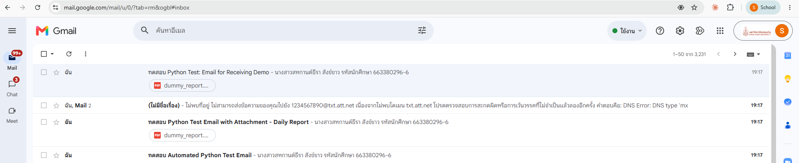
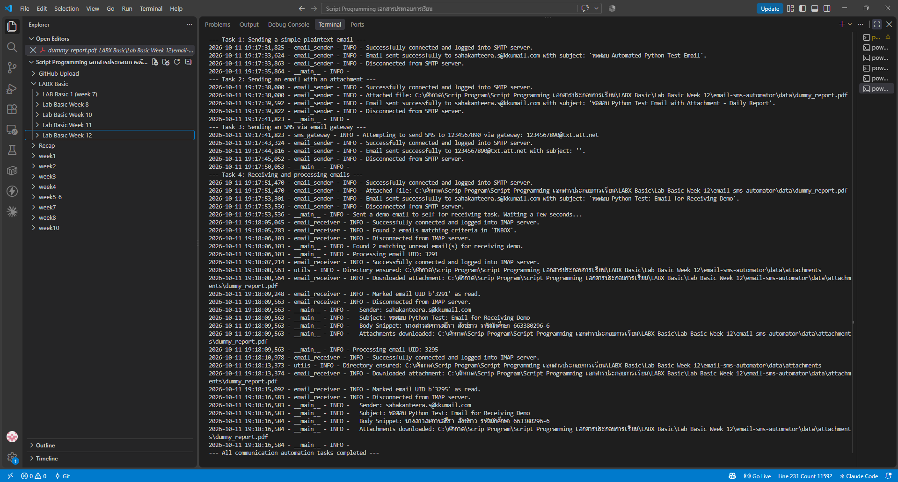

# LabX BASIC (Week 12): Automating Communications (Email & SMS)

ส่งอีเมลอัตโนมัติผ่าน **SMTP** (ข้อความธรรมดา และแนบไฟล์), ส่ง SMS ผ่าน Email-to-SMS Gateway และอ่านอีเมลกลับผ่าน **IMAP** พร้อมดาวน์โหลดไฟล์แนบ โดยใช้ไลบรารีมาตรฐานของ Python (`smtplib`, `imaplib`, `email`) และ `python-dotenv` สำหรับเก็บรหัสผ่านอย่างปลอดภัย

## 🎯 วัตถุประสงค์
- ส่งอีเมลผ่าน SMTP แบบเข้ารหัส STARTTLS และยืนยันตัวตนด้วย Gmail App Password
- สร้างอีเมลแบบ `MIMEMultipart` ที่มีทั้งเนื้อหาและไฟล์แนบ
- ค้นหา อ่าน และดาวน์โหลดไฟล์แนบจากอีเมลผ่าน IMAP (`IMAP4_SSL`)
- จัดการข้อมูลลับด้วยไฟล์ `.env` ไม่ฝังรหัสผ่านไว้ในโค้ด
- ทดสอบโค้ดแบบ offline ด้วย unit test (`unittest` + `mock`)

## 📁 โครงสร้างไฟล์
```text
Week12_LabBasic_EmailSmsAutomator/
├── main.py                  # รัน Task 1–4 ตามลำดับ
├── src/
│   ├── email_sender.py      # EmailSender: ส่งอีเมล SMTP (+ไฟล์แนบ)
│   ├── email_receiver.py    # EmailReceiver: ค้นหา / อ่าน / ดาวน์โหลดไฟล์แนบ IMAP
│   ├── sms_gateway.py       # SMSGateway: ส่ง SMS ผ่าน email gateway
│   └── utils.py             # logging, โหลด .env, สร้างโฟลเดอร์
├── data/
│   ├── dummy_report.pdf     # ไฟล์แนบตัวอย่าง
│   └── attachments/         # ไฟล์แนบที่ดาวน์โหลดจากอีเมล (Task 4)
├── tests/test_automator.py  # unit tests 18 ข้อ (ไม่ต้องต่ออินเทอร์เน็ต)
├── screenshots/
├── .env.example             # แบบฟอร์มการตั้งค่า (ไม่มีรหัสจริง)
└── requirements.txt
```

## ▶️ วิธีรัน
```powershell
python -m venv venv
venv\Scripts\Activate.ps1
pip install -r requirements.txt
copy .env.example .env      # แล้วใส่ SENDER_EMAIL, SENDER_APP_PASSWORD, TEST_RECIPIENT_EMAIL
python main.py
python -m unittest discover -s tests   # รัน unit tests
```

## ✅ ผลการรัน

| Task | ผลลัพธ์ |
|---|---|
| 1. ส่งอีเมลข้อความธรรมดา | ✅ ส่งสำเร็จ เนื้อหา: ชื่อ-นามสกุล และรหัสนักศึกษา |
| 2. ส่งอีเมลพร้อมไฟล์แนบ | ✅ ส่งสำเร็จ แนบ `dummy_report.pdf` |
| 3. ส่ง SMS ผ่าน gateway | ⚠️ โปรแกรมส่งสำเร็จ แต่ปลายทางตีกลับ เพราะ gateway ในโค้ดรองรับเฉพาะเครือข่ายในสหรัฐฯ (AT&T, Verizon ฯลฯ) ไม่มีของไทย (อาจารย์แจ้งว่าส่งไม่ได้ไม่เป็นไร) |
| 4. อ่านอีเมลกลับ (IMAP) | ✅ พบอีเมลที่ยังไม่อ่าน อ่านหัวข้อ/เนื้อหาได้ และดาวน์โหลดไฟล์แนบลง `data/attachments/` |

**อีเมลที่ได้รับใน Gmail** (เนื้อหา: นางสาวสหกานต์ธีรา สังข์ขาว รหัสนักศึกษา 663380296-6)



**ผลลัพธ์ใน Terminal**



## 🐞 บั๊กที่พบและแก้ไข
รันครั้งแรก Task 4 ขึ้น `SEARCH command error: BAD [b'Could not parse command']`
- **สาเหตุ:** `email_receiver.py` ส่งคำค้น `SUBJECT Python Test: Email for Receiving Demo` โดยไม่ครอบด้วยเครื่องหมายคำพูด แต่โปรโตคอล IMAP กำหนดว่าค่าที่มีช่องว่างต้องอยู่ใน `"..."` เซิร์ฟเวอร์จึงอ่านคำสั่งไม่ออก
- **แก้ไข:** ครอบค่า `FROM` และ `SUBJECT` ด้วย `"..."` และปรับ unit test ให้ตรงกัน หลังแก้ Task 4 ทำงานครบ และ unit test ผ่าน 18/18

## ⚖️ Responsible automation
- รหัสผ่านเก็บใน `.env` ซึ่งอยู่ใน `.gitignore` **ไม่ถูกอัปโหลดขึ้น GitHub** และใช้ App Password แทนรหัส Gmail จริง (เพิกถอนได้ทุกเมื่อ)
- ส่งอีเมลทดสอบเข้ากล่องของตัวเองเท่านั้น ไม่ส่งหาผู้อื่นโดยไม่ได้รับอนุญาต
- ระบบส่งข้อความอัตโนมัติควรมีขีดจำกัดจำนวนและเวลาส่ง (มี `time.sleep` คั่น) เพื่อไม่ให้กลายเป็นสแปม

> โค้ดอ้างอิงจาก repo แล็บที่อาจารย์ให้ไว้ (Week12_Lab_BASIC_Automating_Communications_Email_SMS) แก้ไขเนื้อหาอีเมลเป็นชื่อ-รหัสนักศึกษา และแก้บั๊ก IMAP search
