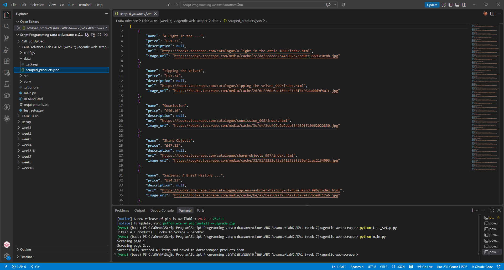

# LabX ADV1 (Week 7): Advanced Web Scraping & Introduction to Automated Agents

สร้าง **Agentic Web Scraper** ด้วย Selenium ที่ทำงานตามไฟล์ configuration (JSON) เปิดเบราว์เซอร์ Chrome แบบ headless ไปที่เว็บ [books.toscrape.com](https://books.toscrape.com) (เว็บที่สร้างไว้ให้ฝึก scraping โดยเฉพาะ) ดึงข้อมูลหนังสือ ไล่ไปหน้าถัดไปอัตโนมัติ แล้วบันทึกเป็น JSON

## 🎯 วัตถุประสงค์
- ใช้ **Selenium WebDriver** ควบคุมเบราว์เซอร์จริง เพื่อดึงข้อมูลจากหน้าเว็บที่โหลดด้วย JavaScript
- ใช้ `webdriver-manager` ดาวน์โหลด ChromeDriver ให้อัตโนมัติ และรันแบบ headless
- ใช้ **Explicit Wait** (`WebDriverWait`), retry และ delay ระหว่างหน้า เพื่อความแข็งแรงและสุภาพต่อเซิร์ฟเวอร์
- ออกแบบแบบ **config-driven agent**: กำหนดเป้าหมาย selector และ pagination ไว้ในไฟล์ JSON แทนการฝังในโค้ด
- เก็บข้อมูลเป็น dataclass `Product` แล้วบันทึกเป็น JSON

## 📁 โครงสร้างไฟล์
```text
Week7_LabADV1_AgenticWebScraper/
├── main.py                          # โหลด config → รัน agent → บันทึก JSON
├── src/
│   ├── config_parser.py             # อ่านและตรวจสอบไฟล์ config
│   ├── driver_manager.py            # ตั้งค่า Selenium WebDriver (Chrome/Firefox, headless)
│   ├── scraper_agent.py             # ตรรกะของ agent: เปิดหน้า → ดึงข้อมูล → ไปหน้าถัดไป
│   ├── data_models.py               # dataclass Product
│   └── utils.py                     # ฟังก์ชันช่วย (บันทึก JSON ฯลฯ)
├── configs/example_site_config.json # "แผน" ของ agent: URL, selector, จำนวนหน้า, delay
├── data/scraped_products.json       # ผลลัพธ์ (สร้างตอนรัน)
├── test_setup.py                    # ทดสอบว่า Selenium + Chrome ใช้งานได้
├── screenshots/
└── requirements.txt
```

## ⚙️ Config ของ agent
| คีย์ | ค่า | ความหมาย |
|---|---|---|
| `start_url` | books.toscrape.com/catalogue/category/books_1/ | หน้าเริ่มต้น |
| `max_pages` | 2 | จำนวนหน้าสูงสุด |
| `delay_between_pages` | 1 | หน่วงเวลา (วินาที) ระหว่างหน้า |
| `item_container_selector` | `article.product_pod` | กล่องของหนังสือแต่ละเล่ม |
| `pagination_selector` | `li.next a` | ปุ่ม "next" |
| `item_data_selectors` | name, price, url, image_url | selector ของแต่ละฟิลด์ |

## ▶️ วิธีรัน (Windows PowerShell) — ต้องมี Google Chrome ในเครื่อง
```powershell
python -m venv venv
venv\Scripts\Activate.ps1
pip install -r requirements.txt
python test_setup.py      # ควรขึ้น Title: All products | Books to Scrape - Sandbox
python main.py
```

## 🖼️ ผลลัพธ์
ได้หนังสือ 2 หน้า × 20 เล่ม = **40 รายการ** บันทึกใน `data/scraped_products.json` (ชื่อ ราคา ลิงก์ ลิงก์รูปปก)

ภาพด้านล่างแสดงทั้งผลใน Terminal (`test_setup.py` และ `main.py` → `Successfully scraped 40 items`) และเนื้อหาไฟล์ `scraped_products.json`



## ⚖️ Responsible scraping
- เว็บเป้าหมายเป็น sandbox ที่ทำขึ้นเพื่อฝึก scraping โดยเฉพาะ ไม่ละเมิด Terms of Service
- จำกัดจำนวนหน้า (`max_pages`) และหน่วงเวลาระหว่างหน้า ไม่สร้างภาระให้เซิร์ฟเวอร์
- การใช้ config แยกจากโค้ดทำให้ตรวจสอบได้ชัดว่า agent จะทำอะไร (transparency / explainability)
- ข้อมูลที่ได้ใช้เพื่อการเรียนเท่านั้น ไม่นำไปเผยแพร่ต่อ

> โค้ดอ้างอิงจาก repo แล็บที่อาจารย์ให้ไว้ (week7/AD1-LabX-ADV / agentic-web-scraper)
