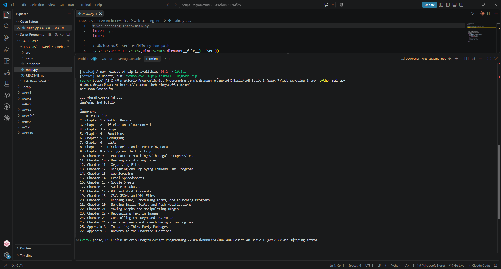

# LAB Basic 1 (Week 7): Introduction to Web Scraping

ดึง **ชื่อหนังสือ** และ **รายชื่อบททั้งหมด** จากเว็บ [Automate the Boring Stuff with Python (3rd Edition)](https://automatetheboringstuff.com/3e/) ด้วย `requests` และ `BeautifulSoup4`

## 🎯 วัตถุประสงค์
- เข้าใจแนวคิดพื้นฐานของ Web Scraping และข้อพิจารณาด้านจริยธรรม/กฎหมาย
- ใช้ `requests` ดาวน์โหลดหน้าเว็บ พร้อมจัดการ error (`try` / `except`, `timeout`, `raise_for_status()`)
- ใช้ `BeautifulSoup` แปลง HTML และดึงข้อมูลด้วย `find()` / `select()`
- จัดโครงสร้างโปรเจกต์แบบ `main.py` + `src/` package และใช้คลาส `SimpleWebScraper`

## 📁 โครงสร้างไฟล์
```text
Week7_LabBasic1_WebScraping/
├── main.py              # จุดเริ่มต้นโปรแกรม: เรียก scraper และแสดงผล
├── src/
│   ├── __init__.py      # บอกว่า src เป็น Python package
│   └── scraper.py       # คลาส SimpleWebScraper (ดาวน์โหลด + แปลง HTML)
├── screenshots/
│   └── result.png       # ผลลัพธ์การรันใน Terminal
├── requirements.txt
└── .gitignore           # ไม่ส่ง venv/ และ __pycache__/ ขึ้น GitHub
```

## ▶️ วิธีรัน (Windows PowerShell)
```powershell
python -m venv venv
venv\Scripts\Activate.ps1
pip install -r requirements.txt
python main.py
```

## 🖼️ ผลลัพธ์
ได้ชื่อหนังสือ `3rd Edition` และรายชื่อบท 27 รายการ (Introduction, Chapter 1–24, Appendix A–B)



## ⚖️ Responsible scraping
- ตรวจ `robots.txt` และ Terms of Service ของเว็บก่อน scrape
- ส่ง request เท่าที่จำเป็น ไม่ยิงถี่จนเป็นภาระเซิร์ฟเวอร์ และตั้ง `timeout` เสมอ
- ถ้าเว็บมี API ให้ใช้ API แทนการ scrape
- เว็บในแล็บนี้เป็นเว็บเพื่อการศึกษาที่เปิดให้อ่านฟรี ข้อมูลที่ได้ใช้เพื่อการเรียนเท่านั้น

> โค้ดอ้างอิงจาก Readme ของแล็บที่อาจารย์ให้ไว้ (LabsX Basic1 – Introduction to Web Scraping)
