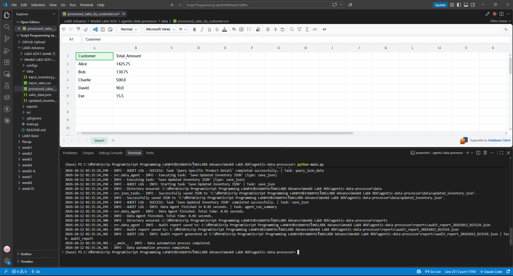
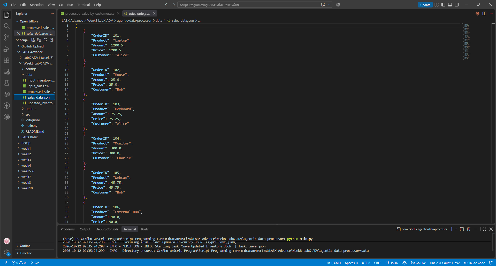
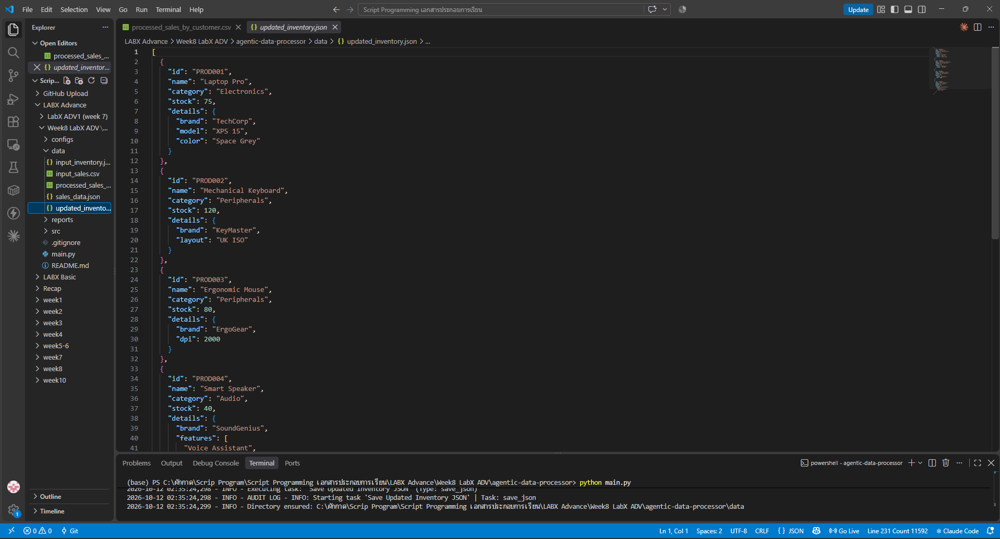

# LabX ADV (Week 8): Agentic Data Processing (Advanced CSV & JSON Workflows)

**Data Agent** ที่ทำงานตาม "แผน" ในไฟล์ config (`data_pipeline_config.json`) ทีละ task: อ่าน CSV/JSON → สรุปยอดขายตามลูกค้า → แปลง CSV เป็น JSON → แก้ไขข้อมูล JSON ที่ซ้อนกันหลายชั้นด้วย path → บันทึกผลลัพธ์ พร้อมสร้าง **audit report** บันทึกทุกขั้นตอน ใช้แค่ไลบรารีมาตรฐานของ Python

## 🎯 วัตถุประสงค์
- ออกแบบ **config-driven agent**: ลำดับงานกำหนดใน JSON แก้แผนได้โดยไม่ต้องแก้โค้ด
- ประมวลผล CSV: group by + sum (`collections.defaultdict`)
- แปลงข้อมูลระหว่าง CSV ↔ JSON
- อัปเดต/เพิ่ม/ค้นหาข้อมูลใน JSON ซ้อนกันด้วย path แบบ `0.details.brand`
- ส่งต่อข้อมูลระหว่าง task ผ่าน `input_data_key` / `output_data_key`
- บันทึก **audit trail** ทุก task (เริ่ม / สำเร็จ / ผิดพลาด) เป็นไฟล์ JSON

## 📁 โครงสร้างไฟล์
```text
Week8_LabADV_AgenticDataProcessor/
├── main.py                              # โหลด config → ตรวจไฟล์ input → รัน DataAgent
├── configs/data_pipeline_config.json    # แผนงาน 9 task ของ agent
├── src/
│   ├── data_agent.py                    # DataAgent: วนทำ task ตาม config + audit log
│   ├── csv_tasks.py                     # load / aggregate / save CSV
│   ├── json_tasks.py                    # load / update / query / save JSON
│   ├── conversion_tasks.py              # แปลง CSV → JSON
│   ├── config_parser.py                 # อ่านและตรวจ config
│   └── utils.py                         # logging, audit entry, สร้างโฟลเดอร์
├── data/
│   ├── input_sales.csv                  # input: ยอดขาย
│   ├── input_inventory.json             # input: สินค้าคงคลัง
│   ├── processed_sales_by_customer.csv  # output
│   ├── sales_data.json                  # output
│   └── updated_inventory.json           # output
├── reports/audit_report_*.json          # output: บันทึกการทำงานของ agent
└── screenshots/
```

## 🧩 แผนงานของ agent (9 task)
| # | Task | ทำอะไร |
|:-:|---|---|
| 1 | Load Sales Data CSV | อ่าน `input_sales.csv` |
| 2 | Aggregate Sales by Customer | รวม `Amount` ตาม `Customer` |
| 3 | Save Aggregated Sales CSV | บันทึก `processed_sales_by_customer.csv` |
| 4 | Convert Raw Sales to JSON | แปลงยอดขาย CSV เป็น JSON |
| 5 | Save Raw Sales JSON | บันทึก `sales_data.json` |
| 6 | Load Inventory Data JSON | อ่าน `input_inventory.json` |
| 7 | Update Inventory | PROD001 stock → 75 และ color → Space Grey, PROD002 layout → UK ISO, PROD003 dpi → 2000, เพิ่ม PROD004 Smart Speaker |
| 8 | Query Product Detail | ค้นหา `0.details.brand` → TechCorp |
| 9 | Save Updated Inventory JSON | บันทึก `updated_inventory.json` |

## ▶️ วิธีรัน
```powershell
python main.py
```
ไม่ต้องติดตั้งไลบรารีเพิ่ม และไม่ต้องใช้ venv (แต่ใช้ก็ได้)

## 🖼️ ผลลัพธ์
**processed_sales_by_customer.csv**



**sales_data.json**



**updated_inventory.json**



## 🐞 สิ่งที่แก้ไขจากโค้ดต้นแบบ
- `src/json_tasks.py` มีบรรทัด `from turtle import update` ซึ่งไม่ได้ใช้งาน (น่าจะเป็น auto-import ของ editor) และทำให้โปรแกรม error บนเครื่องที่ไม่มี `tkinter` จึงลบออก โปรแกรมทำงานเหมือนเดิม

## ⚖️ Responsible automation
- **Audit report** บันทึกทุกขั้นตอนพร้อมเวลา ทำให้ตรวจสอบย้อนหลังได้ว่า agent ทำอะไรกับข้อมูลบ้าง (transparency / explainability)
- ไม่เขียนทับไฟล์ input ผลลัพธ์ทั้งหมดเป็นไฟล์ใหม่
- ตรวจว่าไฟล์ input มีครบก่อนเริ่มทำงาน ถ้าไม่ครบจะหยุดพร้อมแจ้งเหตุผล ไม่ทำงานครึ่งๆ กลางๆ
- ข้อมูลเป็นข้อมูลตัวอย่าง (ชื่อลูกค้าสมมติ)

> โค้ดอ้างอิงจาก repo แล็บที่อาจารย์ให้ไว้ (week8/agentic-data-processor)
