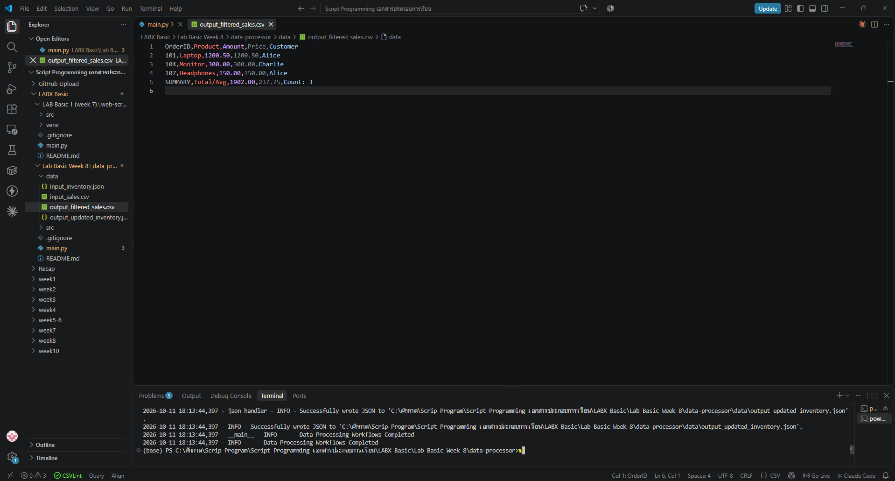
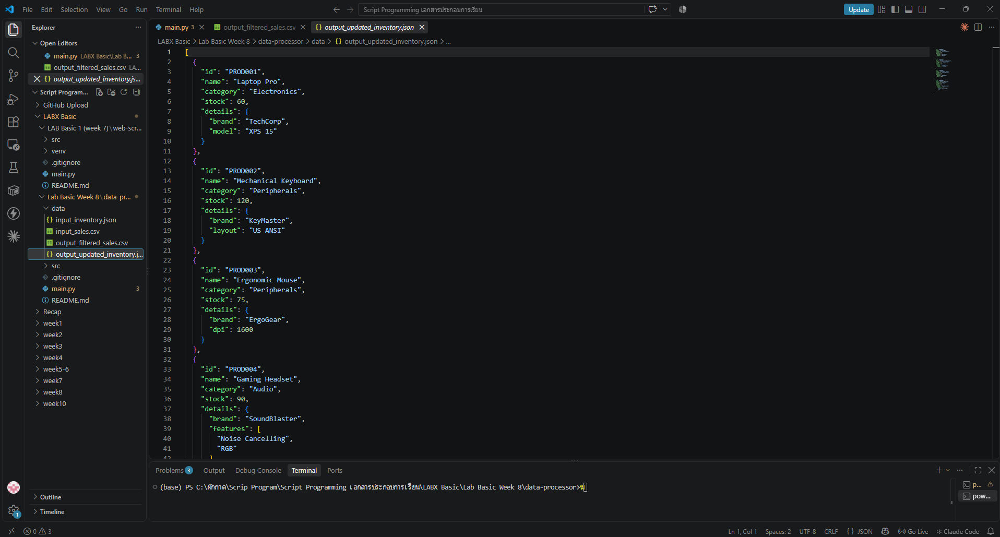

# LAB Basic (Week 8): Automating with CSV and JSON Data

ประมวลผลไฟล์ **CSV** (ข้อมูลยอดขาย) และ **JSON** (ข้อมูลสินค้าคงคลัง) ด้วย Python โดยใช้แค่ไลบรารีมาตรฐาน (`csv`, `json`, `logging`, `os`) ไม่ต้องติดตั้งอะไรเพิ่ม

## 🎯 วัตถุประสงค์
- อ่าน/เขียน CSV ด้วย `csv.DictReader` และ `csv.DictWriter`
- อ่าน/เขียน JSON ด้วย `json.load` และ `json.dump` (รวมถึงข้อมูลซ้อนกันหลายชั้น)
- กรองข้อมูลและสรุปผล เช่น ยอดขายรวม ราคาเฉลี่ย
- จัดโค้ดเป็นคลาส (`CSVHandler`, `JSONHandler`) แยกไฟล์ใน `src/` และบันทึกการทำงานด้วย `logging`
- จัดการ error ด้วย `try` / `except` (ไฟล์ไม่พบ, JSON ผิดรูปแบบ, แปลงตัวเลขไม่ได้)

## 📁 โครงสร้างไฟล์
```text
Week8_LabBasic_DataProcessor/
├── main.py                       # ลำดับขั้นตอน: CSV workflow แล้วต่อด้วย JSON workflow
├── src/
│   ├── __init__.py
│   ├── csv_handler.py            # คลาส CSVHandler: read / write / process_sales_data
│   ├── json_handler.py           # คลาส JSONHandler: read / write / update_inventory / add_product
│   └── utils.py                  # setup_logging, ensure_directory_exists
├── data/
│   ├── input_sales.csv           # ข้อมูลนำเข้า
│   ├── input_inventory.json      # ข้อมูลนำเข้า
│   ├── output_filtered_sales.csv     # ผลลัพธ์ (สร้างตอนรัน)
│   └── output_updated_inventory.json # ผลลัพธ์ (สร้างตอนรัน)
└── screenshots/
```

## ⚙️ โปรแกรมทำอะไร
1. **CSV:** อ่านยอดขาย 8 รายการ เก็บเฉพาะรายการที่ `Amount >= 100` แล้วเพิ่มแถว `SUMMARY` (ยอดรวม 1902.00, ราคาเฉลี่ย 237.75, จำนวน 3 รายการ)
2. **JSON:** อัปเดตสต็อก `PROD001` เป็น 60 และ `PROD003` เป็น 75 แล้วเพิ่มสินค้าใหม่ `PROD004 Gaming Headset`

## ▶️ วิธีรัน
```powershell
python main.py
```

## 🖼️ ผลลัพธ์
**output_filtered_sales.csv**



**output_updated_inventory.json**



## ⚖️ Responsible data handling
- ข้อมูลในแล็บเป็นข้อมูลตัวอย่าง (ชื่อลูกค้าสมมติ) ไม่ใช้ข้อมูลส่วนบุคคลจริง
- เขียนผลลัพธ์ลงไฟล์ใหม่ (`output_*`) ไม่เขียนทับข้อมูลต้นฉบับ ตรวจสอบย้อนหลังได้
- `logging` บันทึกทุกขั้นตอนและแถวที่ข้ามไป ทำให้อธิบายได้ว่าข้อมูลถูกประมวลผลอย่างไร (explainability)

> โค้ดอ้างอิงจาก AllCode.md ของแล็บที่อาจารย์ให้ไว้ (week8/data-processor)
